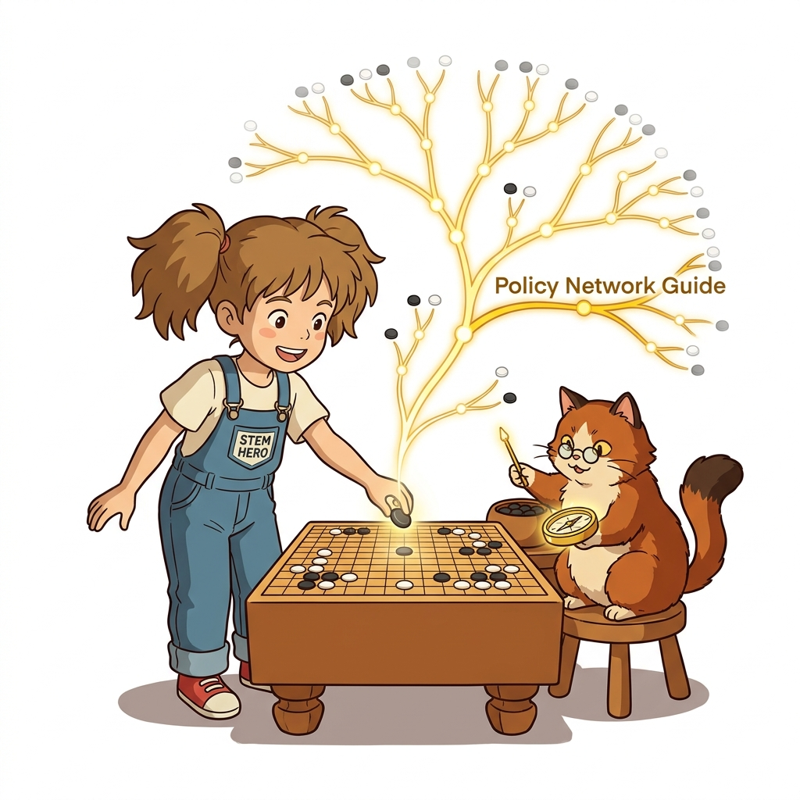

# 18.1 바둑과 AlphaGo: 직관과 수읽기를 결합한 MCTS의 승리


**그림 18-1** 바둑판 위에 흑돌을 놓자 눈앞에 황금빛으로 화려하게 펼쳐지는 몬테카를로 트리 탐색(MCTS)의 미래 경로들을 정책 나침반으로 가이드하는 도로시와 지니

---

> **도로시와 토토의 비유로 이해하기**:
> 바둑은 인간 프로 기사들도 "착수 감각(직관)"과 "장기적인 수읽기(계획)"를 동시에 활용합니다.
> 프로 기사는 바둑판을 언뜻 보고 "여기가 급소군!" 하고 2~3곳의 유망한 자리를 직관적으로 압축한 뒤(정책망), 그 자리들에 대해서만 머릿속으로 20~30수 앞을 깊이 시뮬레이션(MCTS 수읽기)하여 최종 판세를 평가(가치망)합니다.
> 딥마인드의 AlphaGo는 바로 이 인간 최고 기사의 두뇌 메커니즘을 심층 합성곱 신경망과 MCTS의 조화로 완벽히 재현해 낸 걸작입니다!

---

## 18.1.1 바둑의 우주적 복잡성 ($10^{170}$)

체스는 1997년 IBM의 딥 블루(Deep Blue)가 무차별 대입 탐색(Alpha-Beta Pruning)을 통해 세계 챔피언 가리 카스파로프를 꺾었지만, 바둑은 컴퓨터가 인간을 이기려면 수십 년이 더 걸릴 것이라 여겨졌습니다:

| 비교 지표 | 체스 (Chess) | 바둑 (Go) |
| :--- | :---: | :---: |
| **보드 크기** | $8 \times 8 = 64$칸 | **$19 \times 19 = 361$칸** |
| **평균 유효 착수 수 (Branching Factor $b$)** | 약 $35$가지 | **약 $250$가지** |
| **평균 게임 길이 (Game Length $d$)** | 약 $80$수 | **약 $150$수** |
| **상태 공간의 크기 ($b^d$)** | 약 $10^{47}$ | **약 $10^{170}$ (관측 가능한 우주 원자 수 $10^{80}$ 초과)** |
| **휴리스틱 가치 평가** | 말의 가치(점수)로 판세 계산 용이 | **돌의 유기적 생사, 세력 판정이 극도로 모호함** |

---

## 18.1.2 AlphaGo의 3단계 학습 파이프라인

AlphaGo(Silver et al., Nature 2016)는 인간의 학습 과정을 3단계로 모델링했습니다:

1. **1단계: 지도학습 (Supervised Learning, $\pi_{sl}$)**:
   - KGS 바둑 서버의 인간 프로 기사 기보 3,000만 개 국면을 모방하여, 인간 고수가 둘 확률이 높은 수를 예측하는 13층 심층 CNN(합성곱 신경망)을 훈련했습니다. (Top-1 정확도 약 57%)
2. **2단계: 강화학습 자가대국 (Self-Play Reinforcement Learning, $\pi_{rl}$ & $v_{rl}$)**:
   - $\pi_{sl}$을 초기 가중치로 두고, 자기 자신과의 끝없는 자가 대국을 진행하며 승패 보상($+1 / -1$)으로부터 REINFORCE 알고리즘으로 정책을 고도화했습니다.
   - 강화학습 자가대국 데이터로부터, 현재 바둑판 국면을 보고 승률을 $-1.0 \sim +1.0$ 사이의 실수로 정확히 예측하는 **가치 네트워크($v_{rl}$)**를 학습시켰습니다.
3. **3단계: 실전 착수 계획 (MCTS Planning)**:
   - 실제 대국 시에는 단순히 신경망의 출력에만 의존하지 않고, 학습된 $\pi_{sl}$과 $v_{rl}$을 내비게이션 삼아 **몬테카를로 트리 탐색(MCTS)**을 수만 번 수행하여 최적의 착수를 확정합니다.

---

## 18.1.3 AlphaGo의 4대 신경망 아키텍처

AlphaGo 시스템 내부에는 서로 다른 역할을 전담하는 4개의 인공신경망이 탑재되어 있습니다:

```
[인간 기보 3천만 수] ───> [ 1. 지도학습 정책망 (π_sl) ] ───┬───> MCTS 사전 확률 P(s, a) 제공 (탐색 가지치기)
                                │ (가중치 초기화)           │
                                ▼                           │
                         [ 3. 강화학습 정책망 (π_rl) ]       │
                                │ (셀프플레이 대국 생성)     │
                                ▼                           │
                         [ 4. 가치 네트워크 (v_rl) ] ───┼───> MCTS 국면 가치 평가 v(s')
                                                        │
[고속 롤아웃 정책] ───> [ 2. 롤아웃 정책망 (π_rollout) ] ─┴───> MCTS 고속 엔드게임 시뮬레이션 승패 판정 z
```

1. **지도학습 정책망 ($\pi_{sl}$)**: MCTS 탐색 시 방문할 착수의 사전 확률 $P(s, a)$를 제공하여 유망한 몇 가지 수로 탐색 폭을 좁힙니다.
2. **롤아웃 정책망 ($\pi_{\text{rollout}}$)**: 단 2마이크로초($2\mu s$) 만에 다음 수를 두는 초경량 선형 모델로, 게임 끝까지 가상 시뮬레이션을 빠르게 완주(Rollout)하여 승패 $z$를 판정합니다.
3. **강화학습 정책망 ($\pi_{rl}$)**: 자가 대국을 통해 고품질 대국 데이터를 생성하여 가치망을 학습시키는 훈련용 엔진으로만 사용됩니다 (실전 MCTS 탐색에는 직접 투입되지 않음).
4. **가치 네트워크 ($v_{rl}$)**: 임의의 바둑판 국면을 입력받아 즉각 승률을 산출합니다.

---

## 18.1.4 MCTS의 4단계 실행 메커니즘

MCTS는 매 착수마다 수천 번의 가상 시뮬레이션을 반복하며 트리를 확장합니다:

1. **선택 (Selection)**:
   - 루트 노드에서 출발하여 UCB1 수식을 기반으로 가장 유망한 자식 노드를 선택해 내려갑니다:
     $$
     a_t = \arg\max_a \left( Q(s, a) + u(s, a) \right), \quad u(s, a) \propto \frac{P(s, a)}{1 + N(s, a)}
     $$
   - $P(s, a)$는 $\pi_{sl}$의 추천 확률이며, 방문 횟수 $N(s, a)$가 커질수록 보너스 $u(s, a)$가 줄어들어 자연스럽게 탐험(Exploration)과 활용(Exploitation)의 균형을 맞춥니다.
2. **확장 (Expansion)**:
   - 아직 트리에 없는 리프 노드에 도달하면, 정책망 $\pi_{sl}$을 실행하여 가능한 착수들의 사전 확률 $P(s, a)$를 등록하고 노드를 확장합니다.
3. **평가 (Evaluation)**:
   - 확장된 리프 노드의 승률 가치 $V(s)$를 **가치망의 예측값($v(s)$)과 롤아웃 정책망의 빠른 완주 결과($z$)의 5:5 가중합**으로 정밀하게 평가합니다:
     $$
     V(s) = (1 - \lambda) v_\theta(s) + \lambda z \quad (\lambda = 0.5)
     $$
4. **역전파 (Backup)**:
   - 평가된 가치 $V(s)$를 루트 노드까지 거슬러 올라가며 방문한 모든 부모 노드들의 누적 행동 가치 $Q(s, a)$와 방문 횟수 $N(s, a)$를 갱신합니다.

제한 시간이 끝나면, AlphaGo는 $Q$값이 아니라 **가장 많이 방문된 노드($\arg\max_a N(s, a)$)**를 최종 착수(Action)로 선택합니다. 가장 많이 방문되었다는 것은 정책망의 추천과 가치망의 평가 모두에서 철저히 검증되었다는 뜻이기 때문입니다!
