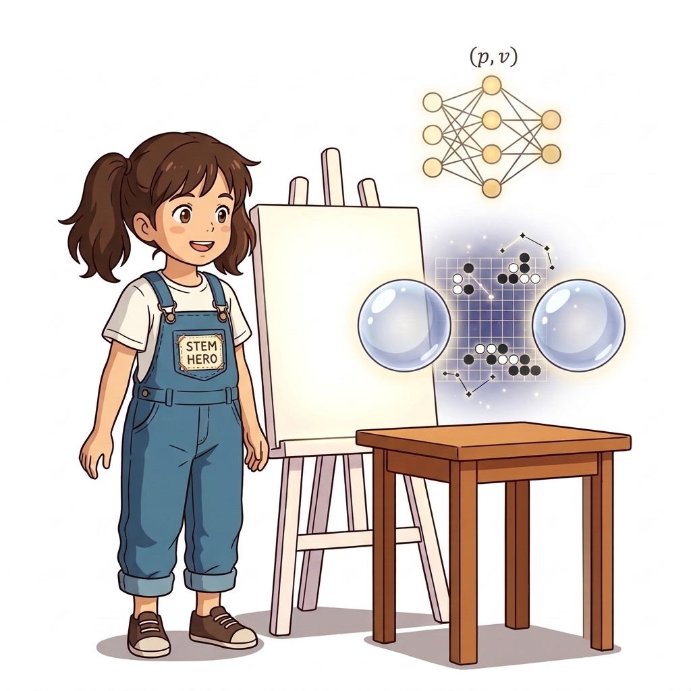

# 18.2 AlphaGo Zero와 AlphaZero: 인간의 지식을 넘어선 백지(Tabula Rasa) 상태에서의 진화


**그림 18-2** 아무것도 그려지지 않은 순백의 캔버스(Tabula Rasa)에서 출발하여, 오직 바둑의 기본 규칙과 자가 대국(Self-Play)만으로 우주적 정석과 신의 한 수를 스스로 터득해 내는 AlphaGo Zero의 경이로운 진화

---

> **도로시와 토토의 비유로 이해하기**:
> 2016년의 AlphaGo는 "인간 프로 기사 선생님의 기보(문제집)"를 먼저 열심히 베껴 푼 우등생이었습니다.
> 하지만 2017년의 **AlphaGo Zero**는 아예 인간의 기보를 단 한 장도 보지 않았습니다! 바둑돌을 놓는 기본 규칙 외에는 완전히 백지(Tabula Rasa) 상태에서 태어난 쌍둥이 AI 둘이서 바둑을 수백만 판 두게 했더니, 불과 사흘 만에 인간이 5천 년 동안 쌓아 올린 모든 정석을 스스로 발견하더니 나흘째에는 인간의 상식을 아득히 초월한 신의 수법들을 터득해 이세돌을 꺾었던 원조 AlphaGo를 100 대 0으로 완파해 버렸습니다!

---

## 18.2.1 AlphaGo Zero의 4대 패러다임 혁신

AlphaGo Zero(Silver et al., Nature 2017)는 이전 AlphaGo 시스템의 모든 복잡한 군더더기를 걷어내고 완벽한 미니멀리즘과 이론적 우아함을 완성했습니다:

| 비교 항목 | AlphaGo (Lee Sedol 버전, 2016) | AlphaGo Zero (2017) |
| :--- | :--- | :--- |
| **인간 지식 활용** | 인간 프로 기보 3,000만 수 지도학습 | **0% (순수 규칙과 Self-play만 활용, Tabula Rasa)** |
| **인공신경망 개수** | **4개** ($\pi_{sl}, \pi_{\text{rollout}}, \pi_{rl}, v_{rl}$) | **단 1개의 통합 2-Head ResNet ($f_\theta(s) = (\mathbf{p}, v)$)** |
| **특징 입력 (Input Features)** | 48개 채널 (단수, 축, 장문 등 인간 휴리스틱 특징) | **단 17개 채널 (흑/백 돌의 최근 8개 위치 이력)** |
| **MCTS 롤아웃** | 고속 롤아웃 정책으로 게임 끝까지 완주 | **롤아웃 완전 폐지 (신경망 가치 $v$만으로 100% 평가)** |
| **하드웨어 효율성** | 수개월 학습, 분산 수백 GPU/TPU | **단 3일 학습, 단일 머신 4개 TPU로 AlphaGo 압도** |

---

## 18.2.2 단일 2-Head ResNet 아키텍처

AlphaGo Zero는 정책망과 가치망을 분리하지 않고, **레즈넷(ResNet, 잔차 신경망)** 백본을 공유하는 단일 신경망으로 통합했습니다:

$$
f_\theta(s) = (\mathbf{p}, v)
$$

[식 18.1] AlphaGo Zero의 2-헤드 출력 함수

- **$\mathbf{p} \in \mathbb{R}^{362}$ (Policy Vector)**: 361개 착수점 + 1개 패스(Pass)에 대한 행동 확률 분포 (사전 확률 $P(s, a)$ 역할)
- **$v \in [-1, +1]$ (Value Scalar)**: 현재 국면에서 현재 플레이어가 최종 승리할 확률을 의미하는 스칼라 가치

### 통합 손실 함수 (Joint Loss Function)
$$
\mathcal{L}(\theta) = (z - v)^2 - \boldsymbol{\pi}^T \log \mathbf{p} + c \|\theta\|^2
$$

[식 18.2] AlphaGo Zero의 손실 함수

- $(z - v)^2$: 실제 자가대국 승패 결과($z \in \{-1, +1\}$)와 가치망 예측($v$) 간의 평균제곱오차
- $-\boldsymbol{\pi}^T \log \mathbf{p}$: MCTS 시뮬레이션을 통해 개선된 탐색 확률 분포($\boldsymbol{\pi}$)와 신경망 출력($\mathbf{p}$) 간의 교차 엔트로피 손실
- $c \|\theta\|^2$: $L_2$ 가중치 감쇠(Weight Decay) 정규화

---

## 18.2.3 MCTS를 정책 개선 연산자(Policy Improver)로 활용하는 원리

AlphaGo Zero의 학습 루프는 4장에서 배웠던 **일반화된 정책 이터레이션(GPI, Generalized Policy Iteration)**의 완벽한 딥러닝 구현체입니다:

```
[ 신경망 f_θ ] ──(가이드)──> [ MCTS 시뮬레이션 ] ──(방문 횟수 통계)──> [ 개선된 정책 π ]
      ▲                                                                     │
      │                                                                     ▼
      └──────────(자가 대국 데이터 (s, π, z)로 손실 최소화)───────────────────┘
```

1. **정책 평가 (Evaluation)**:
   - 현재 신경망 $f_\theta$의 출력 $(\mathbf{p}, v)$를 바탕으로 MCTS를 수행합니다.
2. **정책 개선 (Improvement)**:
   - MCTS는 신경망의 조잡한 직관 $\mathbf{p}$보다 훨씬 깊고 정교한 수읽기를 거쳐, 방문 횟수 분포 $\boldsymbol{\pi} = [N(s, a_1)^{1/\tau}, \dots, N(s, a_{362})^{1/\tau}]$라는 **훨씬 더 강력하고 개선된 정책 $\boldsymbol{\pi}$를 출력**합니다! ($\boldsymbol{\pi} \succ \mathbf{p}$)
3. **지식 증류 (Distillation)**:
   - 신경망 $f_\theta$는 MCTS가 심사숙고하여 내놓은 개선된 정책 $\boldsymbol{\pi}$를 모방하도록 가중치를 갱신합니다.
   - 즉, **"오늘의 MCTS가 내일의 신경망 직관이 되는 영원한 자가 상승 나선"**을 구축한 것입니다!

---

## 18.2.4 AlphaZero: 바둑을 넘어 체스와 쇼기로

2018년 발표된 **AlphaZero(Silver et al., Science 2018)**는 바둑 특화 규칙마저 완전히 걷어내고, **바둑, 체스, 쇼기(일본 장기)라는 세 가지 완전히 다른 게임에 단 한 줄의 알고리즘 변경 없이 동일하게 적용**되었습니다:
- 체스: 단 9시간 만에 2016 세계 컴퓨터 체스 챔피언 Stockfish 격파
- 쇼기: 단 12시간 만에 세계 챔피언 프로그램 Elmo 완파
- 바둑: 단 34시간 만에 AlphaGo Lee 버전 격파

이는 강화학습과 트리 탐색의 결합이 특정 도메인에 갇힌 휴리스틱이 아니라, **범용 인공지능(AGI)을 향한 보편적 의사결정 원리**임을 만천하에 입증한 역사적 순간이었습니다.
