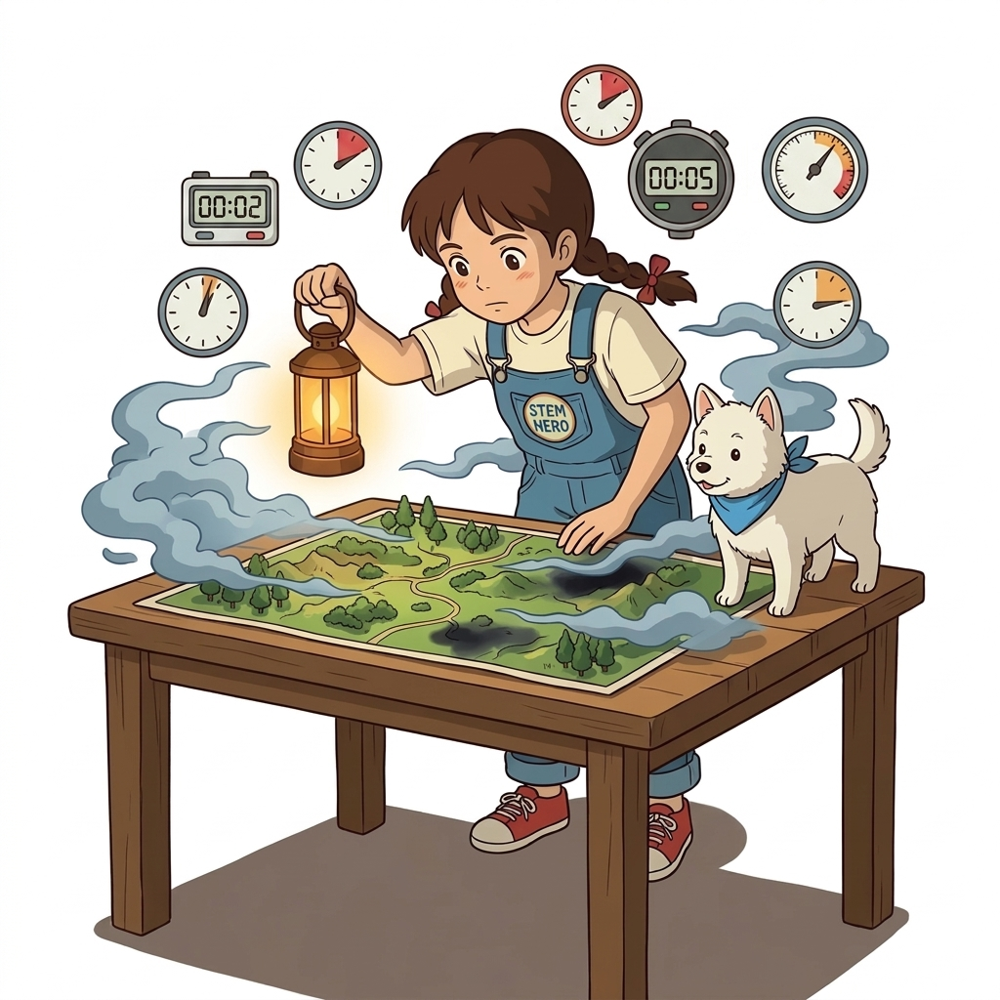

# 18.3 실시간 게임의 도전 과제: 부분 관측(POMDP)과 초거대 조합 행동 공간

**그림 18-3** 전장의 안개(Fog of War)로 뒤덮인 전장 속에서 등불을 비추며 보이지 않는 적의 전략을 추론하고 실시간 결단을 내리는 도로시와 경계하는 토토

---

> **도로시와 토토의 비유로 이해하기**:
> 바둑은 아무리 복잡해도 바둑판의 모든 돌이 내 눈앞에 훤히 다 보이고(완전 정보), 내가 둘 때는 상대방이 얌전히 기다려주는(턴제) 신사적인 게임이었습니다.
> 하지만 스타크래프트나 도타 2 같은 실시간 게임(RTS/MOBA)은 정반대입니다!
> 맵의 90%는 짙은 안개(전장의 안개)에 가려져 있어 적군이 기지에서 뭘 만드는지 보이지 않고(부분 관측, POMDP), 내가 생각하는 1초 동안에도 상대방은 수십 기의 군대를 몰고 쳐들어옵니다(실시간 제어). 게다가 "어떤 유닛을 골라, 어떤 스킬을, 맵의 어느 좌표에, 언제 쓸 것인가?"라는 선택지는 바둑과는 비교도 되지 않는 $10^{26}$가지 조합으로 폭발합니다!

---

## 18.3.1 바둑 vs 실시간 전략 게임(RTS/MOBA) 비교

| 특성 | 바둑 (Go, 완전 정보 턴제) | 스타크래프트 II / Dota 2 (실시간 비완전 정보) |
| :--- | :--- | :--- |
| **관측 가시성** | **완전 관측 (Full Observability, MDP)** 바둑판 전체 상태를 항상 확인 가능 | **부분 관측 (POMDP, Partial Observability)** 전장의 안개(Fog of War)로 적의 위치/의도 미지수 |
| **시간의 흐름** | **이산 턴제 (Discrete Turns)** 내 턴에는 환경이 멈추고 장고 가능 | **연속 실시간 (Continuous Real-Time)** 초당 수십 프레임 진행, 극심한 시간 압박과 지연 |
| **행동 공간 크기** | 약 **$361$가지** (단일 착수점 선택) | **약 $10^{26}$가지 (조합적 다중 행동 폭발)** (행동 유형 $\times$ 대상 유닛 $\times$ 화면 2D 좌표 $\times$ 딜레이) |
| **시간 지평 (Horizons)** | 약 $150 \sim 300$ 스텝 | **$20,000 \sim 80,000$ 틱 (초장기 시계열 크레딧 할당)** |
| **시뮬레이션 가능 여부** | 게임 규칙이 단순하여 MCTS 내부 복제 용이 | 게임 엔진이 너무 무거워 **실시간 트리 탐색(MCTS) 불가능** |

---

## 18.3.2 핵심 난제 1: 부분 관측 마르코프 결정 과정 (POMDP)

실시간 게임에서는 현재 눈앞에 보이는 화면 프레임 $O_t$만으로는 환경의 참 상태 $S_t$를 알 수 없습니다:

$$
S_t \ne O_t
$$

- 5분 전에 정찰기가 보았던 적의 기지 모습, 적군 병력이 어느 방향으로 이동했는가 하는 **과거 관측들의 누적 기억(History)**이 없으면 현재 상태를 올바르게 판단할 수 없습니다.
- 따라서 에이전트는 피드포워드 신경망 대신 과거 시계열 문맥을 기억할 수 있는 **LSTM(Long Short-Term Memory)이나 트랜스포머(Transformer)** 같은 순환 구조를 코어 두뇌로 반드시 탑재해야 합니다:
  $$
  h_t = \text{LSTM}(h_{t-1}, e_t)
  $$

---

## 18.3.3 핵심 난제 2: 초거대 조합적 행동 공간 (Combinatorial Action Space)

스타크래프트 II에서 한 번의 명령을 내리기 위해서는 다음과 같은 복합 파라미터들이 동시에 결정되어야 합니다:

$$
A_t = \left( a^{\text{type}}, \; a^{\text{delay}}, \; a^{\text{unit}}, \; a^{\text{target\_unit}}, \; a^{\text{target\_location}} \right)
$$

1. **행동 유형 ($a^{\text{type}}$)**: 이동, 공격, 건물 건설, 특수 스킬 등 (약 500개)
2. **실행 지연 ($a^{\text{delay}}$)**: 다음 행동을 몇 틱 뒤에 수행할 것인가? (인간 APM 제약 반영)
3. **명령을 내릴 유닛 ($a^{\text{unit}}$)**: 현재 선택 가능한 유닛들 중 누구인가? (최대 수백 개)
4. **목표 유닛 / 타깃 좌표 ($a^{\text{target\_location}}$)**: 맵 전체 $256 \times 256$ 격자 중 어느 위치인가?

이 모든 조합을 곱하면 단 한 스텝에 선택 가능한 행동의 가짓수가 무려 **$10^{26}$가지**를 넘어섭니다!
이는 12장에서 배웠던 단순 Softmax나 $\arg\max_a Q(s, a)$로는 절대 풀어낼 수 없으며, **포인터 네트워크(Pointer Network)를 활용한 자기회귀 정책(Autoregressive Policy)**이라는 혁신적 아키텍처를 요구하게 됩니다.
