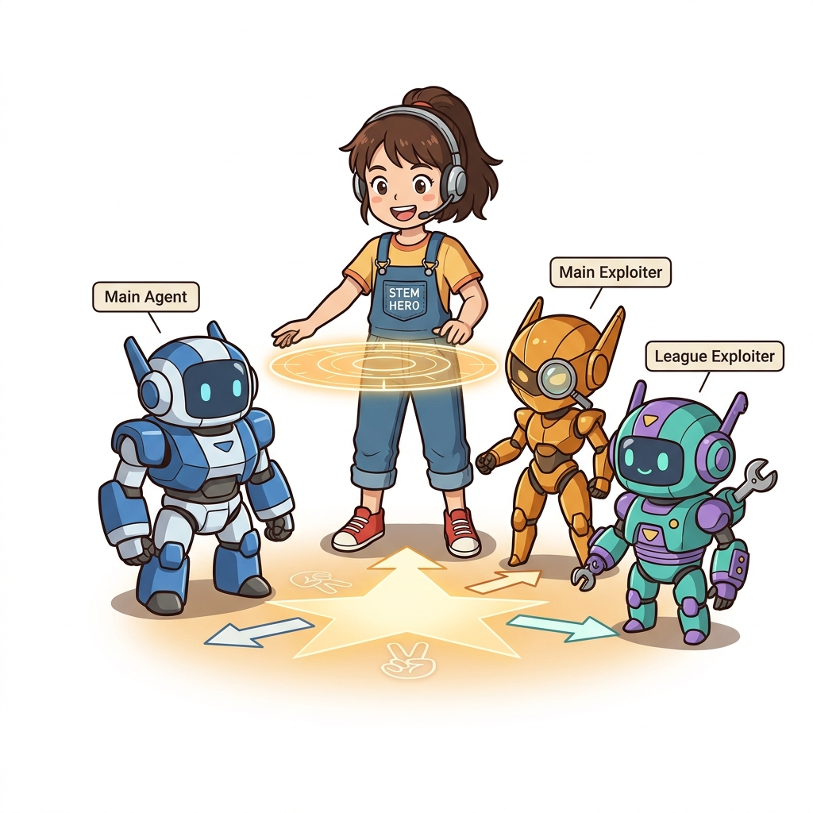

# 18.4 AlphaStar (스타크래프트 II): 리그 트레이닝과 자기회귀 다중 행동 제어


**그림 18-4** 전략적 가위바위보 순환 편향을 깨부수기 위해 Main Agent, Main Exploiter, League Exploiter로 편성된 3대 리그 트레이닝 부대를 지휘하는 사령관 도로시

---

> **도로시와 토토의 비유로 이해하기**:
> 친구와 단둘이서만 스타크래프트를 1,000판 연습하면 어떤 일이 벌어질까요?
> 서로의 버릇만 너무 잘 알게 되어, 예를 들어 "초반 4드론 저글링 러시" 같은 극단적인 꼼수 전략 하나에만 완벽히 특화되어 버립니다(국소 최적화와 과적합). 그러다 대회에 나가 다른 선수의 평범한 운영 전략을 만나면 맥없이 무너지고 맙니다!
> 딥마인드의 **AlphaStar**는 이 '가위바위보 순환 편향'을 깨기 위해, 오직 나(Main Agent)의 약점만 집요하게 파고들어 응징하는 **전문 저격수 봇(Main Exploiter)**과, 세상의 온갖 기상천외한 전략을 실험하는 **탐험가 봇(League Exploiter)**을 따로 만들어 거대한 AI 리그전을 운영했습니다!

---

## 18.4.1 AlphaStar의 신경망 아키텍처 (멀티모달 인코딩)

스타크래프트 II(Vinyals et al., Nature 2019)는 화면 이미지 픽셀만으로는 수백 개의 유닛 속성을 정확히 파악할 수 없습니다. 
AlphaStar는 게임 엔진 인터페이스로부터 추출된 구조화된 데이터를 다음과 같이 3개 인코더로 나누어 처리합니다:

```
[유닛 속성 리스트 (최대 512개)] ───> [ 엔티티 인코더 (Transformer) ] ───┐
                                                                       │
[미니맵 공간 텐서 (지형/시야)]   ───> [ 공간 인코더 (Spatial ConvNet) ] ──┼──> [ 코어 메모리 (Deep LSTM) ]
                                                                       │                 │
[스칼라 자원 정보 (미네랄/가스)] ───> [ MLP 인코더 ]                    ───┘                 │
                                                                                         ▼
                                                                        [ 포인터 네트워크 자기회귀 정책 ]
```

1. **엔티티 인코더 (Entity Transformer)**: 화면에 보이는 아군/적군 유닛(최대 512기) 각각의 체력, 마나, 쿨다운, 좌표 벡터를 Self-Attention 트랜스포머로 처리하여 유닛 간의 상호작용 관계를 파악합니다.
2. **공간 인코더 (Spatial ConvNet)**: 미니맵 전체의 지형 고저차, 아군 시야, 건물의 위치를 2D CNN으로 압축합니다.
3. **코어 메모리 (Core LSTM)**: 인코딩된 모든 특징을 통합하여 과거 전황의 기억 상태($h_t$)를 유지합니다.

---

## 18.4.2 포인터 네트워크(Pointer Network)와 자기회귀 행동 생성

$10^{26}$에 달하는 결합 행동을 한 번에 예측할 수 없으므로, 조건부 확률 체인 규칙(Chain Rule)을 적용하여 **순차적으로 분해하여 결정하는 자기회귀(Autoregressive) 정책**을 사용합니다:

$$
\pi(A_t \mid S_t) = \pi(a^{\text{type}} \mid S_t) \times \pi(a^{\text{delay}} \mid S_t, a^{\text{type}}) \times \pi(a^{\text{unit}} \mid S_t, a^{\text{type}}) \times \pi(a^{\text{target}} \mid S_t, a^{\text{type}}, a^{\text{unit}})
$$

[식 18.3] 자기회귀 행동 분해 공식

- **포인터 네트워크(Pointer Network)**: 내가 명령을 내릴 유닛이나 공격할 목표 유닛을 고를 때, 고정된 번호가 아니라 **현재 엔티티 인코더에 존재하는 유닛 벡터들에 Attention 가중치를 쏘아 특정 유닛을 직접 '지목(Point)'**합니다. 유닛이 몇 기가 있든 가변적인 수의 유닛을 자유자재로 선택할 수 있습니다.

---

## 18.4.3 분산 강화학습 알고리즘: V-Trace와 UPGO

AlphaStar는 수천 개의 분산 게임 환경에서 비동기식으로 데이터를 수집하므로 다음 두 가지 고급 강화학습 기법을 적용했습니다:

1. **V-Trace**:
   - 데이터 수집 시점의 구형 정책 $\mu$와 현재 학습 중인 타깃 정책 $\pi$ 사이의 불일치를 잘라낸 중요도 샘플링(Truncated Importance Sampling)으로 보정하여 안정적인 가치 함수 갱신을 보장합니다.
2. **UPGO (Unrealized Potential Generalized Option)**:
   - 승리한 경기 중에서도 가치 추정치보다 더 높은 성과를 낸 긍정적인 행동 궤적에 대해, 미래 보상이 높을 때만 선택적으로 부트스트래핑하여 좋은 전략을 공격적으로 학습합니다.

---

## 18.4.4 리그 트레이닝 (League Training) 아키텍처

단순한 셀프플레이는 "가위는 바위를 이기지 못하고 바위는 보를 이기지 못하는" **전략적 순환 편향(Non-transitive Cycles)**에 갇히기 쉽습니다. AlphaStar는 이를 타파하기 위해 서로 다른 목적 함수를 가진 3종류의 에이전트로 구성된 **리그(League)**를 운영했습니다:

| 에이전트 종류 | 역할 및 보상 설계 | 목적 |
| :--- | :--- | :--- |
| **Main Agent** | 리그 내의 모든 과거/현재 에이전트를 상대로 가장 범용적인 승률 추구 | 인간 래더 챔피언에 도전할 최종 대표 선수 육성 |
| **Main Exploiter** | **오직 Main Agent의 취약점과 사각지대만을 찾아내어 응징**하도록 보상 설계 | Main Agent가 가진 숨겨진 버그와 편법 꼼수를 원천 제거 |
| **League Exploiter** | 리그 전체 플레이어들의 공통적인 전략적 맹점을 탐색 | 전체 리그가 특정 빌드에 편중되지 않도록 전략적 다양성 확장 |

이 견고한 리그 시스템을 통해 AlphaStar는 프로게이머 마나(TLO, MaNa)와의 공식 대결에서 10대 1로 압승하고 배틀넷 래더에서 인간 최상위 0.15%인 **그랜드마스터(Grandmaster) 티어**에 등극했습니다!
