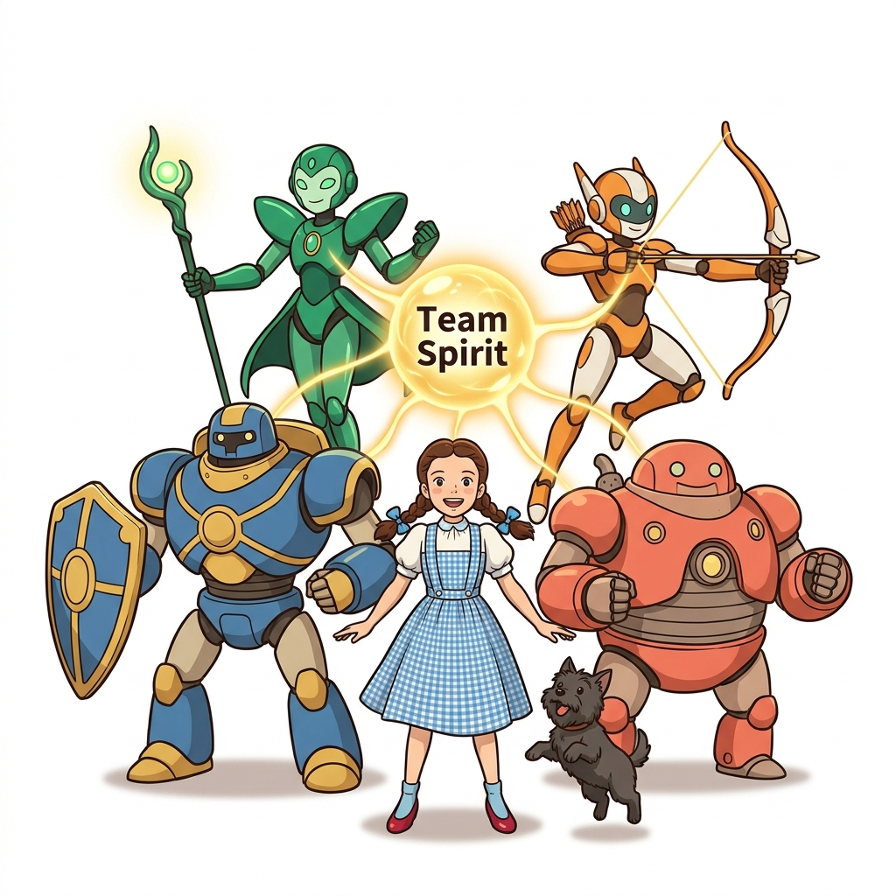

# 18.5 OpenAI Five (Dota 2): 대규모 분산 PPO와 Team Spirit 보상 공유

**그림 18-5** 5인의 영웅 로봇들이 황금빛으로 고동치는 Team Spirit 보상 구체를 중심으로 연결되어, 서로를 위해 희생하고 완벽한 팀플레이를 펼치는 OpenAI Five의 협력 메커니즘

---

> **도로시와 토토의 비유로 이해하기**:
> 5명이 한 팀을 이루어 싸우는 MOBA 게임(Dota 2나 리그 오브 레전드)에서는 "나 혼자 킬을 많이 먹고 잘난 척하는 것"보다, 내가 죽더라도 우리 팀 원거리 딜러를 살려 상대 넥서스를 깨는 **'팀을 위한 희생'**이 훨씬 중요합니다.
> 하지만 AI에게 "팀워크를 발휘해!"라고 말로 명령할 수는 없습니다.
> OpenAI 연구진은 아주 기발한 해결책을 썼습니다: **"개인 보상 점수와 팀 전체의 보상 점수를 황금 비율로 섞어주는 '팀 스피릿(Team Spirit)' 보상 공식"**을 만든 것입니다!
> 에이전트들 사이에 대화나 채팅 통신 기능을 단 한 글자도 넣어주지 않았음에도, 에이전트들은 스스로 아군을 위해 방패가 되어주고 자원을 양보하는 기가 막힌 협동 전술을 자발적으로 깨우쳤습니다!

---

## 18.5.1 Dota 2의 게임 복잡성과 도전 과제

OpenAI Five(Berner et al., 2019)는 세계 최대 e스포츠 대회인 The International의 세계 챔피언 팀 OG를 2:0으로 격파한 시스템입니다:
- **초장기 시간 지평 (Long Time Horizons)**: 한 경기가 45분간 지속되며 초당 30프레임으로 환산하면 **약 80,000 타임스텝**에 달합니다. 10분 전에 와드를 박아둔 사소한 행동이 30분 뒤 한타 대승으로 이어지는 초장기 크레딧 할당(Credit Assignment)이 필요합니다.
- **연속적 행동 조합**: 5명의 영웅이 각자 수십 개의 스킬과 아이템, 맵 이동을 끊임없이 조정해야 합니다.
- **극대 규모 분산 인프라**: 매일 180년 분량의 게임 플레이 데이터를 수집하기 위해 **128,000개의 CPU 코어와 256개의 V100 GPU**가 동시에 동원되었습니다.

---

## 18.5.2 대규모 스케일드 PPO (Scaled PPO)

새로운 복잡한 강화학습 알고리즘을 발명하는 대신, OpenAI는 **16장에서 우리가 배웠던 표준 PPO 알고리즘을 극한의 대규모 분산 클러스터에 안정적으로 확장**했습니다:

- **초거대 미니배치 크기**: 한 번의 PPO 업데이트에 수백만 개의 타임스텝 토큰(약 100만~200만 샘플)을 모아 한 번에 그래디언트를 역전파했습니다.
- **수술적 파라미터 이식 (Surgery)**: 신경망의 크기나 하이퍼파라미터가 바뀔 때, 이전 모델의 가중치를 새 모델로 부드럽게 이식하여 처음부터 다시 학습하는 낭비를 방지했습니다.

---

## 18.5.3 Team Spirit: 명시적 통신 없는 자발적 팀 협력

5개의 영웅 에이전트는 서로 메시지를 주고받는 별도의 통신 채널(Communication Channel)이 전혀 없었습니다. 각 영웅은 독립된 신경망 인스턴스로 제어됩니다.
그렇다면 어떻게 이들은 인간 최고 프로팀을 농락하는 환상적인 한타 협력과 서포팅을 구사했을까요? 

비결은 바로 **팀 스피릿(Team Spirit, $\tau$) 보상 공유 공식**이었습니다:

$$
r_{i, t}^{\text{final}} = (1 - \tau) r_{i, t}^{\text{individual}} + \tau \bar{r}_t^{\text{team}}
$$

[식 18.4] Team Spirit 보상 결합 수식

- $r_{i, t}^{\text{individual}}$: 영웅 $i$ 개인이 획득한 골드, 경험치, 킬 등의 개별 성과
- $\bar{r}_t^{\text{team}} = \frac{1}{5} \sum_{j=1}^5 r_{j, t}$: 팀원 5명이 획득한 전체 보상의 평균치 (포탑 파괴, 한타 승리, 로샨 사냥 등)
- $\tau \in [0, 1]$: 팀 스피릿 계수

### 커리큘럼 학습 (Curriculum of Selflessness)
- **학습 초기 ($\tau = 0.0$)**: 완전히 이기적인 개인 모드로 시작합니다. 일단 각 영웅이 스스로 막타를 치고 경험치를 먹어 생존하는 법을 빠르게 배웁니다.
- **학습 후반 ($\tau \rightarrow 1.0$)**: 팀 스피릿 계수를 $1.0$까지 점진적으로 끌어올립니다. 이제 에이전트는 **자신이 죽더라도 팀 전체가 승리하면 극상의 보상을 받게 되므로**, 서포터 영웅이 적의 궁극기를 대신 맞아주고 캐리 영웅에게 골드를 전량 양보하는 고도의 이타적 팀플레이를 완벽하게 구사하게 되었습니다!
