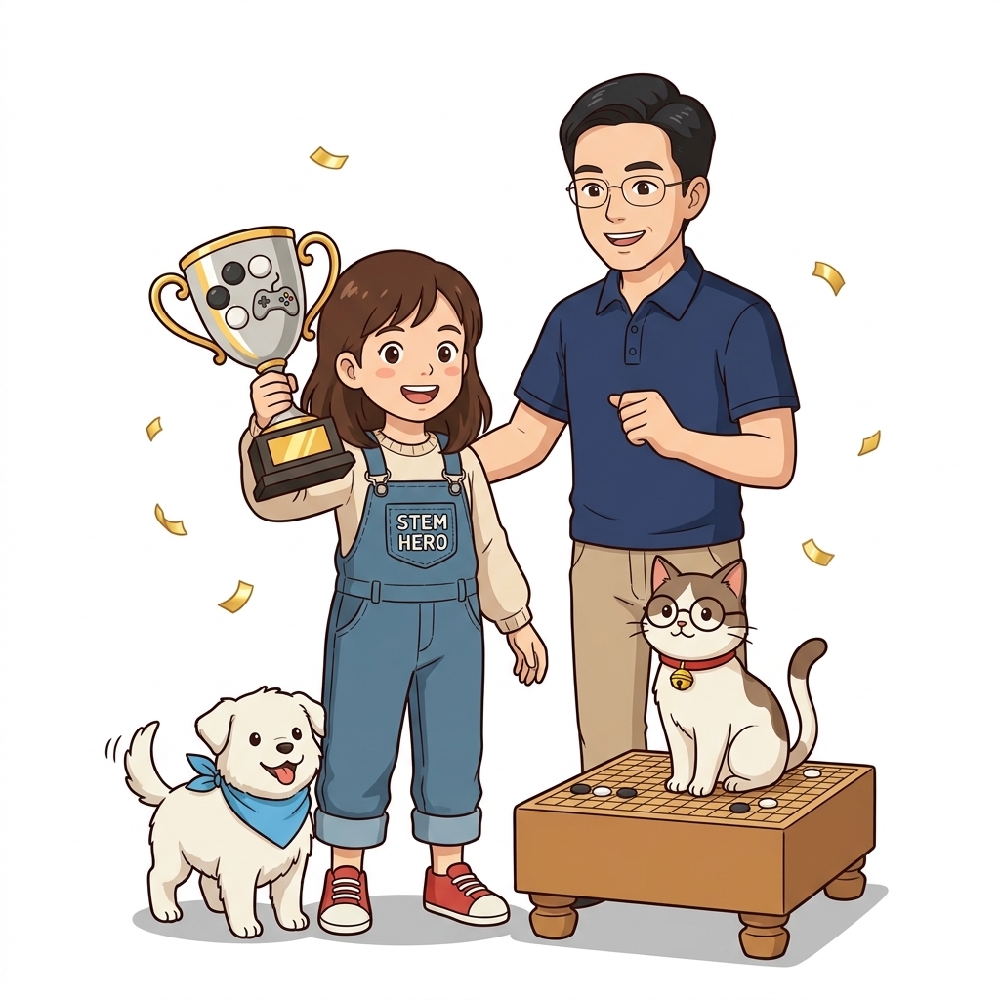

# 18.6 정리 및 요약: 초인류 게임 AI의 아키텍처 비교와 시사점

**그림 18-6** 바둑과 게임 컨트롤러 문양이 새겨진 영광의 트로피를 높이 든 도로시와 환호하는 멘토 이호진 교수님, 그리고 바둑판 위의 지니와 토토

---

## 18.6.1 18장에서 배운 핵심 원리 총정리

1. **바둑과 AlphaGo**:
   - 상태 공간 $10^{170}$의 완전 정보 게임인 바둑에서, 프로 기사의 지도학습 정책($\pi_{sl}$)과 셀프플레이 가치망($v_{rl}$)을 **몬테카를로 트리 탐색(MCTS)**의 휴리스틱 가이드로 결합하여 직관과 장기 수읽기의 이상적 결합을 달성했습니다.
2. **AlphaGo Zero와 AlphaZero**:
   - 인간의 기보와 사전 지식을 100% 배제(Tabula Rasa)하고 순수 바둑 규칙과 자가 대국(Self-Play)만으로 학습했습니다.
   - 단일 2-헤드 ResNet($f_\theta(s) = (\mathbf{p}, v)$)과 롤아웃이 제거된 MCTS를 정책 개선 연산자(Policy Improver)로 활용하여 완전한 일반화(체스, 쇼기, 바둑)를 실현했습니다.
3. **실시간 게임(RTS/MOBA)의 난제**:
   - 전장의 안개로 인한 부분 관측(POMDP), 실시간 연속 지연, 초거대 조합 행동 공간($10^{26}$)이라는 3대 난제가 존재합니다.
4. **AlphaStar (스타크래프트 II)**:
   - 엔티티 트랜스포머, 공간 CNN, 코어 LSTM, 포인터 네트워크 기반 자기회귀 정책, V-Trace 및 가위바위보 순환 편향을 극복한 **리그 트레이닝(Main & Exploiter)**으로 그랜드마스터 레벨을 달성했습니다.
5. **OpenAI Five (Dota 2)**:
   - 128,000 CPU 코어 기반의 대규모 분산 PPO와 **Team Spirit($\tau$) 보상 공유** 메커니즘을 통해, 명시적 통신 없이도 5개 에이전트 간의 자발적 희생과 협력 전술을 완성했습니다.

---

## 18.6.2 3대 초인류 게임 AI 시스템 종합 비교표

| 비교 항목 | AlphaGo Zero (바둑) | AlphaStar (스타크래프트 II) | OpenAI Five (Dota 2) |
| :--- | :--- | :--- | :--- |
| **게임 유형** | 완전 정보 턴제 게임 | 부분 관측 실시간 전략 (RTS) | 부분 관측 실시간 5v5 팀플레이 (MOBA) |
| **상태 표현** | 2D 보드 텐서 ($19 \times 19 \times 17$) | 엔티티 리스트(Transformer) + 미니맵(CNN) | 16,000차원 벡터 (영웅/유닛 속성) |
| **코어 메모리** | 없음 (현재 국면만으로 충분) | **심층 LSTM (전장의 안개 추론)** | **단일 거대 LSTM (1024 유닛)** |
| **행동 생성** | 362개 이산 확률 Softmax | **포인터 네트워크 자기회귀 정책** | 분해된 계층적 다중 행동 헤드 |
| **핵심 알고리즘** | MCTS 기반 정책 이터레이션 | V-Trace + UPGO + 리그 트레이닝 | **스케일드 분산 PPO** |
| **협력 메커니즘** | 해당 없음 (1대1 대전) | 해당 없음 (1대1 대전) | **Team Spirit 보상 공유 메커니즘** |

---

## 18.6.3 확인 퀴즈 (Quiz)

**Q1. AlphaGo Zero가 기존 AlphaGo(이세돌 대국 버전) 대비 네트워크 구조 및 탐색 방식에서 혁신한 가장 큰 차이점 두 가지는 무엇인가요?**
- **정답**:
  1. 4개의 분리된 신경망을 **단일 2-헤드 ResNet($\mathbf{p}, v$)으로 통합**함.
  2. 고속 롤아웃 정책망에 의한 무작위 시뮬레이션을 폐지하고, **가치망의 예측값만으로 리프 노드를 즉시 평가**함.

**Q2. OpenAI Five에서 5명의 영웅 에이전트 사이에 명시적인 텍스트 채팅이나 통신 채널이 전혀 없음에도 불구하고 자발적인 희생과 팀워크가 창발할 수 있었던 이유는 무엇인가요?**
- **정답**: **Team Spirit 보상 공유 공식**을 통해 개인의 보상과 팀 전체 보상을 융합하여, 궁극적으로 팀이 승리해야만 개인도 최고 보상을 받도록 보상 체계를 정렬했기 때문입니다.

---

## 18.6.4 다음 장(Chapter 19)으로의 도약

게임 AI는 완벽한 게임 엔진 시뮬레이터 속에서 수십만 년 분량의 가상 경험을 쌓으며 기적을 만들었습니다.
그렇다면 체스판이나 비디오 게임 엔진이 주어지지 않는 **현실 세계(로봇, 자율주행, 물리적 환경)**에서는 어떻게 수십만 년의 시뮬레이션을 돌릴 수 있을까요?

다음 19장에서는 에이전트가 현실 세계의 물리 법칙과 인과관계를 스스로 학습하여 뇌 속에 가상의 환경 시뮬레이터를 창조하는 궁극의 기술, **월드 모델(World Models)**과 **Dreamer**, **Genie**, 그리고 **NVIDIA Cosmos**의 신세계로 떠나봅니다!
