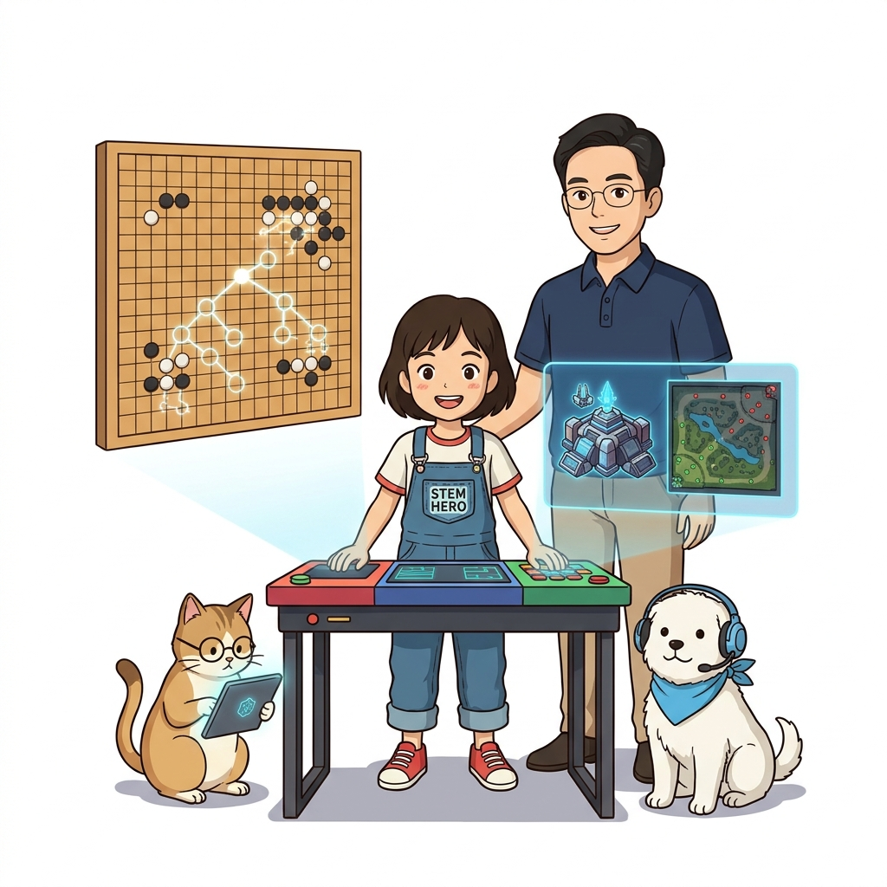

# CHAPTER 19 게임과 강화학습: AlphaGo에서 AlphaStar와 OpenAI Five까지

**그림 18-0** 19x19 바둑판의 신의 한 수(AlphaGo)부터 스타크래프트 II(AlphaStar)와 도타 2(OpenAI Five)의 실시간 전장을 지휘하며 게임 인공지능의 정점에 도전하는 도로시와 지니, 그리고 멘토 이호진 교수님

---

> **도로시와 토토의 비유로 이해하기**:
> 게임은 인공지능 연구자들에게 가장 완벽한 '디지털 풍동 시험장(Wind Tunnel)'입니다!
> 바둑은 우주의 모든 원자 수($10^{80}$)보다 훨씬 많은 $10^{170}$개의 우주적 경우의 수를 자랑하고, 실시간 전략 게임(RTS/MOBA)은 짙은 안개 속에서 수백 개의 유닛을 초당 수십 번씩 동시 조작해야 하는 극한의 전장입니다.
> 딥마인드와 OpenAI는 바로 이 게임이라는 도전 과제를 통해 강화학습의 한계를 극한까지 밀어붙였습니다. 인간의 지혜를 모방하던 알파고에서 시작하여, 인간의 기보를 완전히 잊고 자가 대국(Self-Play)만으로 초인류의 경지에 도달한 알파고 제로, 그리고 복잡한 팀워크를 스스로 깨우친 인공지능의 서사시를 함께 탐험해 봅시다!

---

## 18.0 개요: 게임 AI가 증명한 강화학습의 위대함

게임은 명확한 보상 체계(승리, 패배, 점수), 완벽한 시뮬레이션 환경, 그리고 인간 챔피언이라는 명확한 벤치마크가 존재하기 때문에 지난 10년간 강화학습의 비약적 도약을 이끈 가장 핵심적인 무대였습니다.

본 18장에서는 컴퓨터 과학 역사상 가장 위대한 이정표로 꼽히는 3대 게임 AI 시스템을 집중 해부합니다:
1. **바둑 (Go)**: 완전 정보 턴제 게임 (AlphaGo & AlphaGo Zero)
   - 지도학습(SL), 강화학습(RL), 그리고 **몬테카를로 트리 탐색(MCTS)**의 유기적 결합
   - 인간의 사전 지식을 배제하고 순수 셀프플레이(Self-Play)만으로 완성된 탭뷸라 라사(Tabula Rasa) 패러다임
2. **스타크래프트 II (StarCraft II)**: 부분 관측 실시간 전략 게임 (AlphaStar)
   - 전장의 안개(Fog of War), $10^{26}$에 달하는 초거대 조합적 행동 공간
   - 멀티모달 트랜스포머/LSTM, 포인터 네트워크(Pointer Network), 그리고 가위바위보 순환 편향을 극복한 **리그 트레이닝(League Training)**
3. **Dota 2**: 5대5 팀플레이 협력 게임 (OpenAI Five)
   - 장기적 시간 지평(수만 틱), 명시적 통신 채널 부재
   - 대규모 분산 PPO와 **보상 공유(Team Spirit)**를 통한 자발적 팀워크와 전략적 역할 분담 형성

---

## 학습 로드맵 (Roadmap)

1. **[18.1 바둑과 AlphaGo](./19_1_바둑과_AlphaGo/)**:
   - 바둑의 수학적 복잡성과 AlphaGo의 3단계 학습 파이프라인
   - 4대 인공신경망($\pi_{sl}, \pi_{\text{rollout}}, \pi_{rl}, v_{rl}$)과 MCTS의 가이드 결합
2. **[18.2 AlphaGo Zero와 AlphaZero](./19_2_AlphaGo_Zero와_AlphaZero/)**:
   - 인간 기보를 완전히 배제한 백지(Tabula Rasa) 상태에서의 진화
   - 2-헤드 단일 신경망($\mathbf{p}, v$)과 MCTS 기반 셀프플레이 정책 이터레이션
3. **[18.3 실시간 게임의 도전 과제](./19_3_실시간_게임의_도전_과제/)**:
   - 턴제 바둑 vs 실시간 RTS/MOBA 게임의 근본적 차이
   - POMDP(부분 관측), 실시간 연속 지연, 초거대 조합 행동 공간
4. **[18.4 AlphaStar (스타크래프트 II)](./19_4_AlphaStar_스타크래프트_II/)**:
   - 엔티티 인코더(Transformer)와 공간 인코더(CNN), 코어 LSTM
   - 포인터 네트워크 자기회귀 정책, V-Trace, Main & Exploiter 리그 트레이닝
5. **[18.5 OpenAI Five (Dota 2)](./19_5_OpenAI_Five_Dota_2/)**:
   - 수만 CPU 코어 기반 스케일드 PPO 분산 아키텍처
   - Team Spirit 보상 공유 메커니즘을 통한 협력적 팀플레이
6. **[18.6 정리 및 요약](./19_6_정리/)**:
   - 게임 AI 아키텍처 비교표, 확인 퀴즈, 19장(월드 모델)으로의 연결
