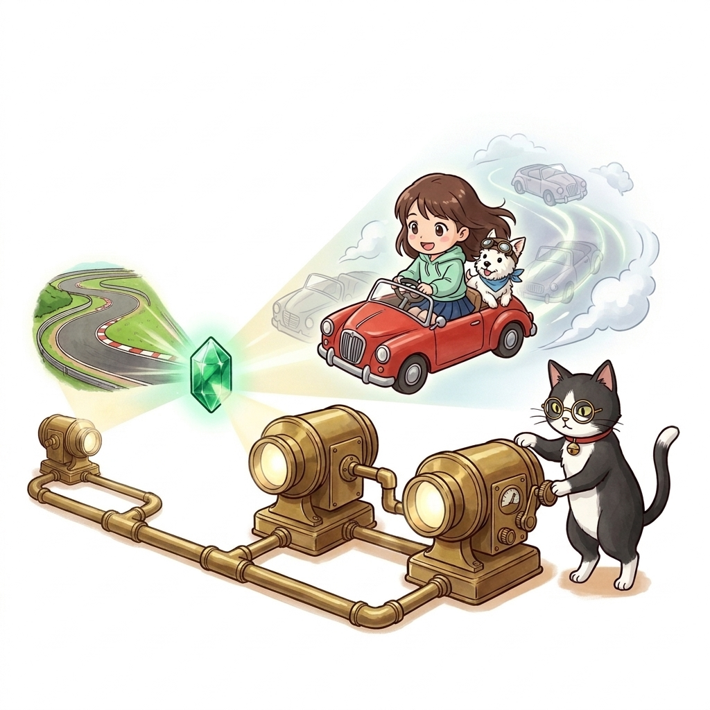

# 20.2 World Models 아키텍처

**그림 20-2** 시각 VAE 렌턴, 기억 MDN-RNN 프로젝터, 그리고 상상속 가상 트랙에서 빨간색 미니카를 직접 운전하는 제어기로 구성된 데이비드 하 & 위르겐 슈미트후버의 World Models 삼원 구조를 시연하는 도로시와 지니, 토토


---

> **지니의 아키텍처 다이어그램 노트**:
> "2018년 구글 브레인의 데이비드 하(David Ha)와 LSTM의 창시자 위르겐 슈미트후버(Jürgen Schmidhuber)가 발표한 **World Models** 논문은 전 세계 AI 연구진에게 엄청난 충격을 주었습니다.
> 그들은 복잡한 에이전트의 두뇌를 단 세 개의 모듈(V, M, C)로 분리했습니다.
> 1. 세상을 보는 눈: **Vision Model ($V$)**
> 2. 과거를 기억하고 미래를 예측하는 뇌: **Memory Model ($M$)**
> 3. 단순하고 직관적인 반사신경: **Controller ($C$)**
> 그리고 에이전트가 현실 환경에 단 한 번도 발을 들이지 않고, 오직 '자신이 꾼 꿈(Dream)' 속에서만 훈련받은 뒤 현실에 나와 만점을 기록하는 기적 같은 실험을 성공시켰습니다!"

---

### 1. 3대 핵심 구성 모듈 (V, M, C)

World Models는 하나의 거대한 복잡한 신경망 대신, 기능별로 철저하게 분리된(Decoupled) 세 개의 핵심 모듈로 구성됩니다:

```
[World Models의 3대 핵심 모듈 상호작용]

         원시 관측 프레임 (x_t)
                  │
                  ▼
         ┌─────────────────┐
         │ 시각 모델 (V)   │ ──> 변분 오토인코더 (VAE)
         └────────┬────────┘     고차원 픽셀을 잠재 공간 벡터 z_t (32차원)로 압축
                  │
                  ├─── z_t ───────────────────┐
                  ▼                           ▼
         ┌─────────────────┐         ┌─────────────────┐
  a_t ──>│ 기억 모델 (M)   │ ── h_t ─>│  제어기 (C)     │ ──> 행동 (a_t)
         └─────────────────┘         └─────────────────┘
           MDN-RNN (순환신경망)         단순 1-Layer 선형 모델
           z_t와 a_t로 미래 z_{t+1} 예측  [z_t, h_t]를 받아 a_t 즉각 출력
```

#### 1) Vision Model ($V$: VAE)
* **역할**: 매 시점 입력되는 $64 \times 64 \times 3$ 고해상도 컬러 프레임 $x_t$를 저차원 정규분포 잠재 공간 벡터 $z_t \in \mathbb{R}^{32}$로 압축합니다.
* **학습 목표**: VAE의 증거 하한(ELBO) 손실 함수:
  $$\mathcal{L}_V = \mathbb{E}_{q(z|x)} [\log p(x|z)] - D_{\text{KL}}(q(z|x) \parallel p(z))$$
* 시각 모델 덕분에 에이전트는 12,288차원의 시각 픽셀 노이즈를 32차원의 핵심 물리 표현으로 다룰 수 있게 됩니다.

#### 2) Memory Model ($M$: MDN-RNN)
* **역할**: 현재의 잠재 상태 $z_t$와 에이전트가 취한 행동 $a_t$를 입력받아, 과거의 히스토리 은닉 상태 $h_t$를 갱신하고 **다음 시점의 잠재 상태 $z_{t+1}$의 확률 분포**를 예측합니다.
* **MDN-RNN (Mixture Density Network + LSTM)**:
  * 미래는 단 하나의 점이 아니므로, 미래 잠재 벡터 $z_{t+1}$를 $K$개의 가우시안 정규분포의 혼합 모델(GMM)로 출력합니다:
    $$P(z_{t+1} \mid a_t, z_t, h_t) = \sum_{k=1}^{K} \pi_k(h_t) \mathcal{N}\left(z_{t+1}; \mu_k(h_t), \sigma_k^2(h_t)\right)$$
* **내적 시뮬레이터(월드 모델)**의 심장이 바로 이 $M$ 모델입니다.

#### 3) Controller ($C$: Linear Policy)
* **역할**: 현재의 시각 표현 $z_t$와 과거의 기억 및 미래 예측 맥락이 담긴 은닉 상태 $h_t$를 이어붙인 벡터 $[z_t, h_t]$를 입력받아 최종 행동 $a_t$를 출력합니다:
  $$a_t = \tanh(W_c [z_t, h_t] + b_c)$$
* **특징**: $V$와 $M$이 환경의 물리 법칙을 완벽히 흡수했기 때문에, 제어기 $C$는 파라미터 수가 불과 수백~수천 개에 불과한 극도로 단순한 1-계층 선형 모델(Linear Controller)로도 충분히 강력합니다.
* 복잡한 역전파 대신 **진화 전략(CMA-ES: Covariance Matrix Adaptation Evolution Strategy)**으로 매우 빠르고 안정적으로 가중치를 최적화할 수 있습니다.

---

### 2. 분리형 3단계 학습 파이프라인

World Models의 가장 위대한 설계 미학은 각 모듈을 완전히 독립적으로 순차 학습시키는 파이프라인에 있습니다:

1. **1단계: 데이터 수집 및 V 모델 비지도 학습**:
   - 무작위 정책 에이전트를 환경에 주행시켜 1만 편의 에피소드 프레임 롤아웃을 수집합니다.
   - 강화학습 보상과 전혀 무관하게, 순수 컴퓨터 비전 관점에서 VAE를 비지도 학습시켜 프레임 복원 능력을 완성합니다.
2. **2단계: M 모델 자기회귀 학습**:
   - VAE로 인코딩된 시계열 잠재 벡터 시퀀스 $(z_0, a_0, z_1, a_1, \dots)$를 이용해 MDN-RNN을 다음 스텝 잠재 예측 문제로 자기지도 학습(Self-supervised Learning)시킵니다.
3. **3단계: 제어기 C 학습 (꿈속에서의 상상 학습)**:
   - 이제 실제 게임 환경을 완전히 끕니다!
   - 에이전트는 $M$과 $V$가 만들어내는 가상의 꿈(Dream Environment) 속에서만 $C$를 시뮬레이션 훈련합니다.

---

### 3. "꿈속에서의 학습 (Learning in the Dream)"

Ha & Schmidhuber는 유명한 2D 탑다운 레이싱 게임 **CarRacing-v0**와 3D 슈팅 게임 **VizDoom**에서 이 월드 모델을 실증했습니다:

```
[꿈속에서의 가상 시뮬레이션 루프]

    초기 잠재 상태 z_0 생성 ──> [ C: 제어기 ] ──> 행동 a_0 산출
             ▲                                       │
             │                                       ▼
             └────── [ M: MDN-RNN (월드 모델) ] <────┘
                     다음 잠재 상태 z_1 = Sample(P(z_1 | z_0, a_0, h_0))
```

* 에이전트는 오직 MDN-RNN이 예측하는 꿈속의 잠재 롤아웃만을 보며 CarRacing의 핸들을 꺾는 법을 배웠습니다.
* 학습이 끝난 $C$를 실제 게임 환경에 투입하자, 실제 환경과 단 한 번도 상호작용하지 않고 꿈속에서만 훈련받은 에이전트가 현실 환경에서 **인간 플레이어 기록을 경신하고 만점(900점 이상)**을 기록하며 트랙을 완주했습니다.
* 이는 복잡한 외부 세계를 몇 개의 생성 신경망 모듈로 완전히 뇌 속에 내재화할 수 있음을 입증한 인공지능 역사상 위대한 마일스톤이 되었습니다.
