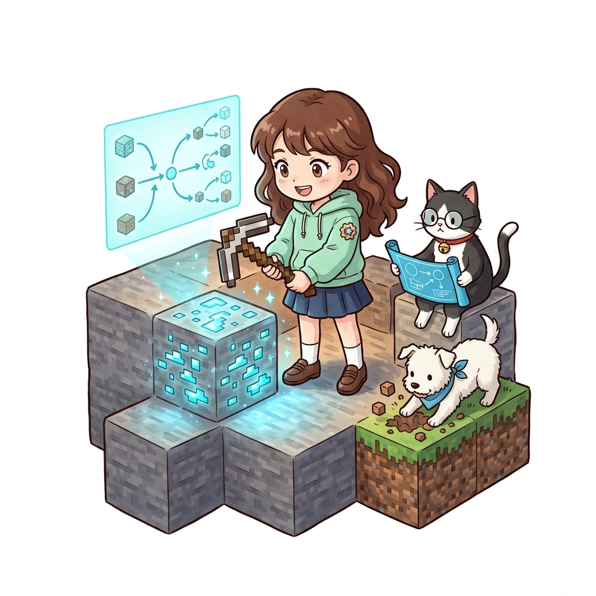

# 20.3 행동 학습의 확장: Dreamer

**그림 20-3** 마인크래프트 복셀 지하 동굴에서 Dreamer의 잠재 상상 롤아웃 홀로그램을 보며 마침내 희귀한 청록빛 다이아몬드 원석을 채굴하는 데 성공한 도로시와 지니, 토토


---

> **도로시와 지니의 마인크래프트 탐험기**:
> "Ha & Schmidhuber의 초기 World Models는 2D 레이싱처럼 단순한 환경에서는 잘 동작했지만, 제어기를 진화 전략(CMA-ES)으로 풀었기 때문에 복잡한 다단계 의사결정에서는 한계가 있었어요.
> 이때 다니야 하프너(Danijar Hafner)가 이끄는 연구팀이 등장하여 **Dreamer**를 발표했습니다!
> Dreamer는 월드 모델 내부에서 **액터-크리틱(Actor-Critic)**을 결합하여, 잠재 공간의 무한한 상상 롤아웃을 통해 신경망의 분석적 그래디언트를 역전파합니다. 그 결과, 인간도 몇 시간을 공들여야 하는 마인크래프트에서 사전 지식 없이 다이아몬드를 스스로 채굴해 내는 경이로운 성과를 거두었습니다!"

---

### 1. Dreamer의 패러다임: 잠재 공간 상상 롤아웃 (Latent Imagination)

초기 World Models는 상상된 미래 잠재 벡터를 다시 디코더를 통해 화면 픽셀로 복원하거나, 제어기의 파라미터가 작아야만 학습이 가능했습니다.

**Dreamer 시리즈(DreamerV1, V2, V3, V4)**의 핵심 돌파구는 다음과 같습니다:

1. **픽셀 복원 없는 완전한 잠재 공간 학습**:
   - 상상 단계에서 무거운 이미지 픽셀 디코딩을 일체 수행하지 않고, 오직 저차원 잠재 벡터 공간 내부에서만 미래를 롤아웃합니다.
2. **해석적 그래디언트 역전파 (Analytic Policy Gradient)**:
   - 월드 모델이 미분 가능한 신경망이므로, 미래의 상상된 보상과 가치 함수를 거쳐 정책 신경망까지 **시간 역전파(BPTT: Backpropagation Through Time)**를 통해 그래디언트를 직접 흘려보냅니다.
3. **액터-크리틱과의 결합**:
   - 잠재 상태 $z$를 입력받는 액터 $\pi_\phi(a|z)$와 크리틱 $v_\psi(z)$를 상상된 잠재 궤적 속에서 동시에 훈련시킵니다.

```
[Dreamer의 잠재 공간 상상 훈련 파이프라인]

              실제 환경 경험 수집 ──> 버퍼에 저장
                       │
                       ▼
          [ 순환 상태공간 모델 (RSSM) 학습 ]
                       │
     ┌─────────────────┴─────────────────┐
     ▼                                   ▼
 [ 잠재 공간 상상 롤아웃 ]           [ 액터-크리틱 학습 ]
 (Imagined Latent Rollouts)          Actor: 정책 개선
 z_t ──> z_{t+1} ──> z_{t+2} ...     Critic: 가치 추정 (λ-return)
```

---

### 2. 순환 상태공간 모델 (RSSM: Recurrent State-Space Model)

Dreamer의 가장 핵심적인 인공신경망 심장은 **RSSM(Recurrent State-Space Model)**입니다.

현실 세계는 **과거의 맥락을 길게 기억해야 하는 결정론적(Deterministic) 흐름**과 **다양한 우연이 발생하는 확률적(Stochastic) 불확실성**이 공존합니다. RSSM은 이 두 가지를 하나로 융합했습니다:

$$s_t = (h_t, z_t)$$

* **결정론적 은닉 상태 ($h_t$)**: GRU/LSTM과 같은 순환신경망으로 과거의 모든 시계열 이력을 압축 기억합니다:
  $$h_t = f_\theta(h_{t-1}, z_{t-1}, a_{t-1})$$
* **확률적 잠재 상태 ($z_t$)**: 불확실성을 표현하는 범주형(Categorical) 또는 가우시안 잠재 변수입니다:
  $$z_t \sim p_\theta(z_t \mid h_t) \quad (\text{사전 분포 / Prior})$$
  $$z_t \sim q_\phi(z_t \mid h_t, x_t) \quad (\text{사후 분포 / Posterior})$$

```
[RSSM의 내부 상태 전이 구조]

       h_{t-1} ──────[ GRU 전이 ]──────> h_t ──────[ GRU 전이 ]──────> h_{t+1}
          │                               │                               │
          ▼                               ▼                               ▼
       z_{t-1}                         z_t                             z_{t+1}
          │                               │                               │
          ▼                               ▼                               ▼
    [ 관측 복원 x ]                 [ 관측 복원 x ]                 [ 관측 복원 x ]
    [ 보상 예측 r ]                 [ 보상 예측 r ]                 [ 보상 예측 r ]
    [ 지속 여부 γ ]                 [ 지속 여부 γ ]                 [ 지속 여부 γ ]
```

RSSM은 관측 복원($\hat{x}_t$), 보상 예측($\hat{r}_t$), 에피소드 지속 확률($\hat{\gamma}_t$)을 동시에 예측하며, 사후 분포와 사전 분포 사이의 KL 발산을 최소화하여 미래 예측 능력을 극대화합니다.

---

### 3. 마인크래프트(Minecraft) 정복 성과 (DreamerV3)

마인크래프트는 장기 지연 보상(Long-horizon Sparse Reward)과 방대한 3D 오픈월드 크래프팅 트리로 인해 강화학습 연구자들에게 "마지막 남은 난공불락의 요새"로 불렸습니다.

* 나무를 베어 목재를 만들고, 작업대를 조합해 나무 곡괭이를 만들고, 돌을 캐 돌 곡괭이로 업그레이드하고, 철광석을 캐 화로에 구워 철 곡괭이를 만든 뒤, 지하 깊은 용암 지대에서 다이아몬드를 캐내기까지 수만 스텝 이상의 완벽한 인과적 행동 연결고리가 필요합니다.
* **DreamerV3**는 인간의 기보 데이터셋이나 도메인 특화 보상 엔지니어링 없이, **단 하나의 고정된 하이퍼파라미터 세트만으로 마인크래프트에서 다이아몬드를 처음부터 스스로 채굴하는 데 성공**한 세계 최초의 범용 알고리즘이 되었습니다.

월드 모델 내부에서 수백만 번의 채굴과 조합 과정을 초고속으로 상상하고 검증함으로써, 모델 프리 방식으로는 수백 년이 걸릴 탐색을 불과 며칠 만에 학습해 낸 것입니다.
