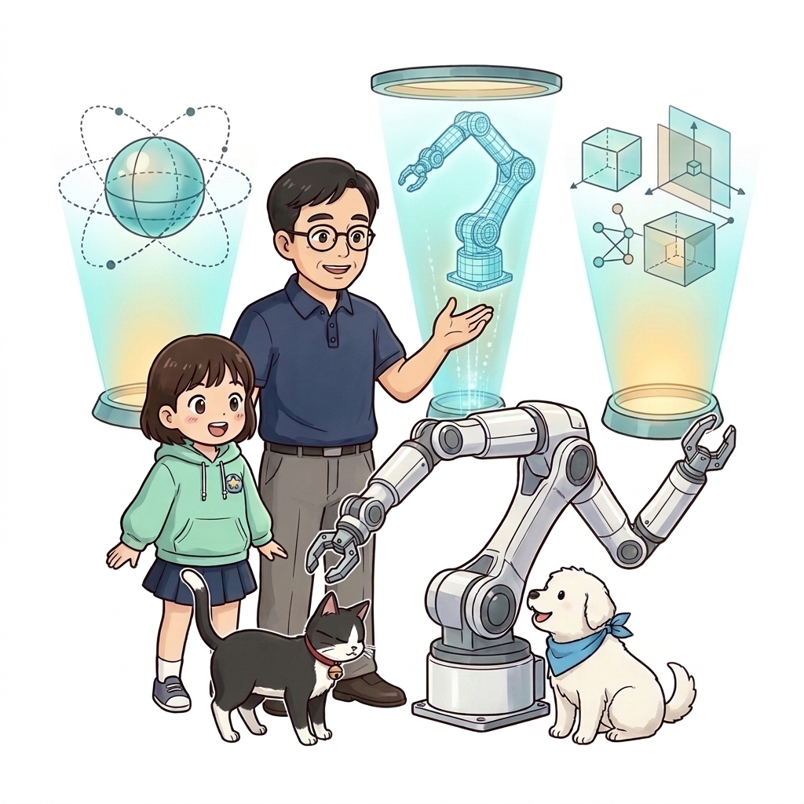

# 20.5 물리 세계 예측의 확장: NVIDIA Cosmos

**그림 20-5** 정밀한 로봇 매니퓰레이터 주변으로 미래 물리 궤적을 예측하는 Predict, 디지털 트윈을 현실로 전이하는 Transfer, 물리적 상식을 추론하는 Reason의 삼원 기둥을 시연하는 호진 교수님과 도로시 연구진


---

> **호진 교수님의 피지컬 AI 특강**:
> "지금까지의 월드 모델이 아타리, 둠, 마인크래프트 같은 비디오 게임 세계에 머물러 있었다면, 2025~2026년 인공지능의 최전선은 **물리적 실체(Physical Embodiment)를 가진 로봇이 살아가는 현실 세계**로 옮겨왔습니다.
> 젠슨 황과 엔비디아(NVIDIA)가 발표한 **Cosmos**는 중력, 마찰력, 충돌, 유체역학 등 지구상의 모든 물리 법칙을 내재화한 **피지컬 AI(Physical AI) 파운데이션 월드 모델 플랫폼**입니다. 로봇이 현실에서 컵을 깨뜨리지 않고 정밀하게 쥐는 법부터 자율주행차가 빙판길에서 미끄러지지 않는 법까지, 초거대 물리 시뮬레이션으로 해결합니다."

---

### 1. 피지컬 AI와 월드 모델의 필연적 융합

거대언어모델(LLM)이 인간의 '언어 세계'를 정복했다면, 로봇과 자율주행이 직면한 다음 프론티어는 '물리 세계'입니다.
* 언어 모델은 텍스트의 다음 단어를 예측하지만, 로봇은 **"내가 컵을 밀었을 때 컵이 굴러떨어질지, 물이 쏟아질지"**라는 물리적 인과관계를 예측해야 합니다.
* 실제 물리 환경에서 수억 번의 로봇 실험을 수행하는 것은 물리적 파손과 시간의 한계로 불가능합니다.
* **NVIDIA Cosmos**는 비디오 생성 기술, 확산 트랜스포머(Diffusion Transformer), 대규모 3D 물리 시뮬레이션 데이터를 결합하여 **현실의 완벽한 디지털 트윈 시뮬레이터**를 제공합니다.

---

### 2. NVIDIA Cosmos의 3대 핵심 아키텍처 (Predict, Transfer, Reason)

NVIDIA Cosmos는 피지컬 AI 에이전트를 개발하기 위한 세 가지 상호보완적인 파운데이션 모델 제품군으로 구성됩니다:

```
┌────────────────────────────────────────────────────────────────────────┐
│                   NVIDIA Cosmos World Foundation Platform              │
└───────────────────────────────────┬────────────────────────────────────┘
                                    │
       ┌────────────────────────────┼────────────────────────────┐
       ▼                            ▼                            ▼
┌──────────────────┐       ┌──────────────────┐       ┌──────────────────┐
│  Cosmos Predict  │       │  Cosmos Transfer │       │  Cosmos Reason   │
│  (시공간 물리 예측)│       │  (환경 도메인 변환)│       │  (물리적 상식 추론)│
└──────────────────┘       └──────────────────┘       └──────────────────┘
 - 7B/14B Diffusion         - World-to-World 변환      - VLM 기반 물리 추론
 - 중력, 마찰, 변형 시뮬      - 가상(Sim) ──> 현실(Real)  - "컵이 깨질 위험 판정"
 - 궤적 및 다이내믹스 생성    - 날씨/조명/센서 노이즈     - 에이전트 안전 가이드
```

#### 1) Cosmos Predict (미래 상태 시공간 예측 모델)
* **구조**: 70억(7B) 및 140억(14B) 파라미터의 확산 트랜스포머(DiT: Diffusion Transformer) 모델.
* **기능**: 현재 카메라 이미지와 로봇의 액추에이터 제어 명령(모터 토크, 휠 속도)을 조건으로 받아, **앞으로 발생할 물리적 변화를 초당 수십 프레임의 고해상도 비디오로 예측**합니다.
* **물리적 엄밀성**: 단순한 픽셀 보간이 아닌 질량, 관성, 탄성, 유체 흐름 등 엄격한 물리 법칙을 준수하여 물체가 겹치거나 왜곡되는 환각(Hallucination)을 원천 차단합니다.

#### 2) Cosmos Transfer (World-to-World 조건부 환경 변환 모델)
* **기능**: 가상 시뮬레이터(Isaac Sim 등)에서 렌더링된 인공 그래픽 데이터를 현실 세계의 거친 질감, 비바람, 눈보라, 역광 등 **실제 센서 노이즈가 반영된 초실사 영상으로 도메인 변환**합니다.
* **Sim-to-Real 간극 해소**: 시뮬레이션에서 1초 만에 생성된 데이터에 현실의 거친 물리 효과를 입혀 에이전트를 훈련시킴으로써, 가상에서 학습한 로봇이 현실 환경에 투입되었을 때 발생하는 성능 저하(Reality Gap)를 극복합니다.

#### 3) Cosmos Reason (피지컬 AI를 위한 시각언어 추론 모델)
* **기능**: 시각-언어 모델(VLM)에 물리적 직관을 결합하여, **환경 내 물체들의 물리적 관계와 잠재적 위험성을 논리적으로 추론**합니다.
* **추론 예시**:
  - "저 투명한 유리잔은 가볍고 미끄러우므로 그리퍼의 압력을 20% 줄이고 고무 패드 마찰력을 활용해 쥐어야 한다."
  - "앞쪽 바닥에 젖은 얼음판이 있으므로 감속하지 않으면 차량이 제어 불능 상태가 된다."

---

### 3. 차세대 통합 모델: Cosmos 3 (Omnimodal World Foundation Model)

2026년에 선보인 **Cosmos 3**는 예측(Predict), 변환(Transfer), 추론(Reason)으로 나뉘어 있던 세 모델을 단일한 **옴니모달(Omnimodal) 파운데이션 월드 모델**로 완전히 통합했습니다.

* 시각(RGB), 깊이(Depth), 포인트 클라우드(Point Cloud), 언어(Text), 고유수용감각(Proprioception: 모터 각도 및 부하)을 단일 잠재 공간에서 처리합니다.
* 로봇은 Cosmos 3라는 강력한 내적 두뇌를 통해, 현실 세계에서 단 한 번도 보지 못한 생소한 물건이나 재난 상황에 직면하더라도 스스로 가상의 시뮬레이션을 돌려보며 최선의 물리적 행동을 안전하게 계획할 수 있게 되었습니다.
