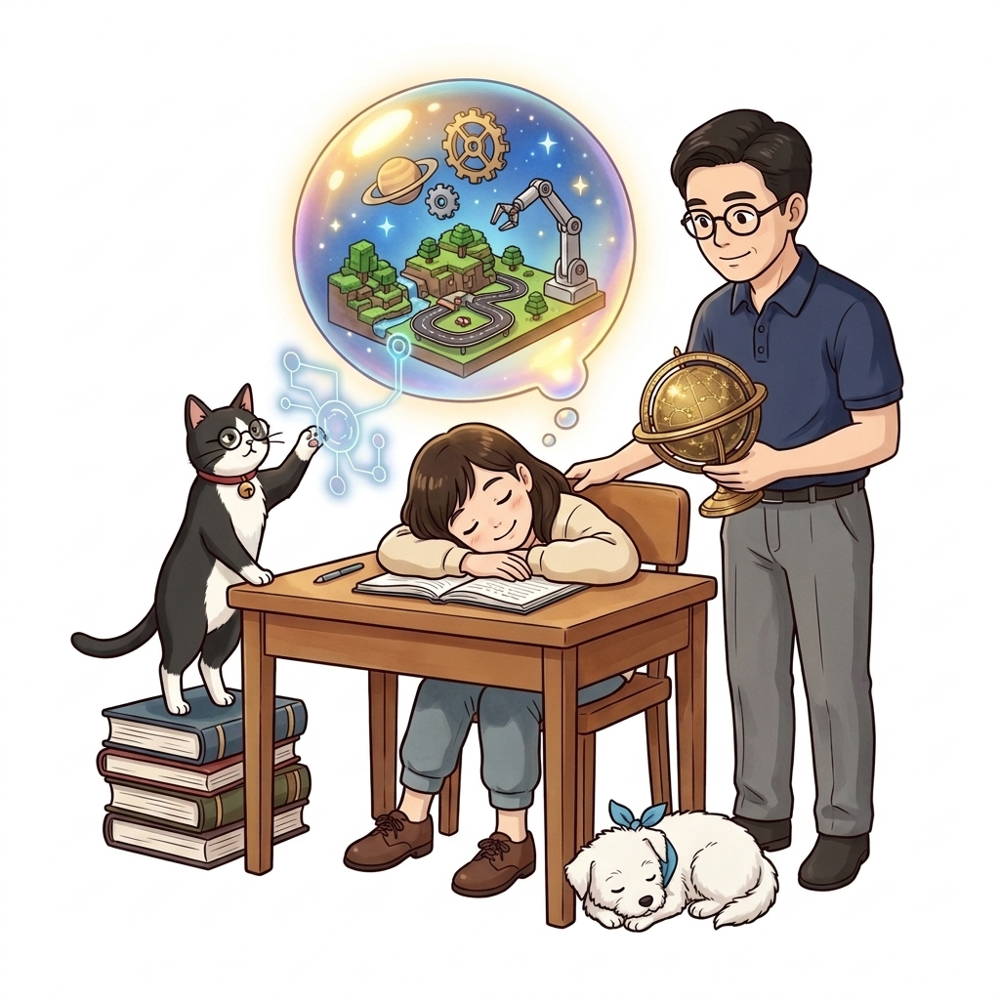

# CHAPTER 20 월드 모델 (World Models)

**그림 20-0** 꿈속에서 펼쳐지는 상상의 시뮬레이션 우주(월드 모델)를 설계하고 관찰하는 도로시와 지니, 그리고 호진 교수님


---

> **도로시와 지니의 탐험 노트로 이해하기**:
> "우리가 위험한 절벽이나 낯선 동굴을 탐험할 때, 무작정 앞으로 발을 헛디뎌 낭떠러지로 떨어지는 모험가는 없어요. 머릿속으로 '내가 저 돌을 밟으면 미끄러질까? 저 바위를 짚으면 안전할까?'라고 마음속 상상의 시뮬레이터(Mental Model)를 미리 돌려보죠!
> 강화학습 에이전트도 마찬가지입니다. 실제 환경과 위험천만하게 수억 번 부딪히며 배우는 대신, 환경의 물리 법칙을 압축한 **내부 시뮬레이터(월드 모델, World Model)**를 마음속에 구축하고, **꿈속에서 수백만 번의 미래를 초고속으로 상상하며 최적의 정책을 학습**하는 궁극의 인공지능 패러다임이 바로 월드 모델입니다!"

---

### 1. 월드 모델의 탄생 배경과 패러다임

지금까지 우리가 배웠던 심층 강화학습은 대부분 **모델 프리(Model-free)** 기법이었습니다. 환경의 전이 확률 $P(s'|s, a)$를 전혀 모른 채, 실제 환경에 끝없이 행동을 가하고 돌아오는 보상과 다음 상태를 관측하며 시행착오를 겪었습니다.

하지만 자율주행차나 휴머노이드 로봇처럼 현실 세계에서 직접 시행착오를 겪으면:
1. **막대한 샘플 비효율성**: 인간은 몇 분 만에 배우는 게임을 인공지능은 수천만 번의 프레임을 돌려야 학습합니다.
2. **치명적인 안전 문제**: 자율주행차가 보행자를 치거나 충돌하는 사고를 직접 겪으며 배울 수는 없습니다.
3. **환경 시뮬레이터의 병목**: 실제 환경의 물리 엔진 연산 속도에 학습 속도가 종속됩니다.

**월드 모델(World Model)**은 생성 모델(Generative Models)의 비약적 발전에 힘입어 에이전트 내부에 환경의 물리 법칙과 인과관계를 모방하는 **내적 시뮬레이터**를 탑재함으로써 이 모든 한계를 근본적으로 해결합니다:

```
[Model-free vs Model-based (World Models)의 의사결정 구조]

1. 모델 프리 (Model-free):
   현재 상태 (s) ──> [ 신경망 정책 ] ──> 실제 환경에 행동(a) 투입 ──> 시행착오 반복 (위험 & 느림)

2. 월드 모델 (World Models):
   현재 상태 (s) ──> [ 월드 모델 (내부 시뮬레이터) ] ──> 잠재 공간(Latent Space)에서 수천 번의 미래 상상 ──> 안전하고 최적화된 행동 결정
```

---

### 2. 이번 장에서 배우는 핵심 내용

본 장에서는 고려사이버대학교 강화학습 14주차 교육과정에 발맞추어, 인지과학적 정신 모형에서 출발하여 생성형 AI와 피지컬 AI(Physical AI)의 핵심 파운데이션으로 자리 잡은 현대 월드 모델의 전체 스펙트럼을 완벽하게 마스터합니다:

1. **[20.1 월드 모델의 개념과 생성 모델의 역할](./20_1_월드_모델의_개념과_생성_모델의_역할/)**:
   - 인지과학적 정신 모형(Mental Model)과 제어이론의 동역학 모델
   - 2 $\times$ 2 매트릭스 (Model-free vs Model-based, Policy vs Value)
   - 생성 모델(Generative Modeling)이 월드 모델에서 수행하는 핵심 역할
2. **[20.2 World Models 아키텍처 (Ha & Schmidhuber, 2018)](./20_2_World_Models_아키텍처/)**:
   - 3대 핵심 구성 모듈: 시각 모델 $V$ (VAE), 기억 모델 $M$ (MDN-RNN), 제어기 $C$
   - 분리형 3단계 학습 파이프라인과 "꿈속에서의 상상 학습(Learning in the Dream)"
3. **[20.3 행동 학습의 확장: Dreamer](./20_3_행동_학습의_확장_Dreamer/)**:
   - 잠재 공간 상상 롤아웃을 통한 액터-크리틱 최적화 (Danijar Hafner et al.)
   - 순환 상태공간 모델 (RSSM: Recurrent State-Space Model)
   - 마인크래프트(Minecraft) 다이아몬드 채굴 성공 (DreamerV3/V4)
4. **[20.4 가상 환경 생성의 확장: Genie](./20_4_가상_환경_생성의_확장_Genie/)**:
   - Google DeepMind Genie (Bruce et al., 2024)
   - 잠재 행동 모델(LAM)과 라벨 없는 비디오 기반 인터랙티브 환경 생성
   - 단 한 장의 스케치/이미지로 플레이 가능한 게임 월드 구축 메커니즘
5. **[20.5 물리 세계 예측의 확장: NVIDIA Cosmos](./20_5_물리_세계_예측의_확장_NVIDIA_Cosmos/)**:
   - 차세대 피지컬 AI(Physical AI) 파운데이션 월드 모델 플랫폼
   - 3대 축: Cosmos Predict (미래 시공간 예측), Cosmos Transfer (디지털 트윈 Sim-to-Real), Cosmos Reason (물리적 인과 추론)
   - 옴니모달 파운데이션 모델 Cosmos 3의 비전
6. **[20.6 정리](./20_6_정리/)**:
   - 20장 핵심 요약 및 비교 분석표
   - 객관식 퀴즈 및 심층 해설
   - **1장부터 20장까지의 강화학습 대단원 완강 기념 로드맵 총결산**

상상력(Imagination)과 생성 모델을 무기로 무한한 가상 우주를 누비는 월드 모델의 경이로운 세계로 함께 떠나봅시다!
