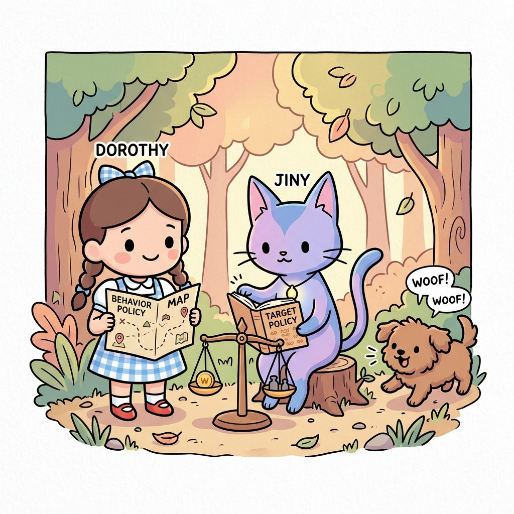
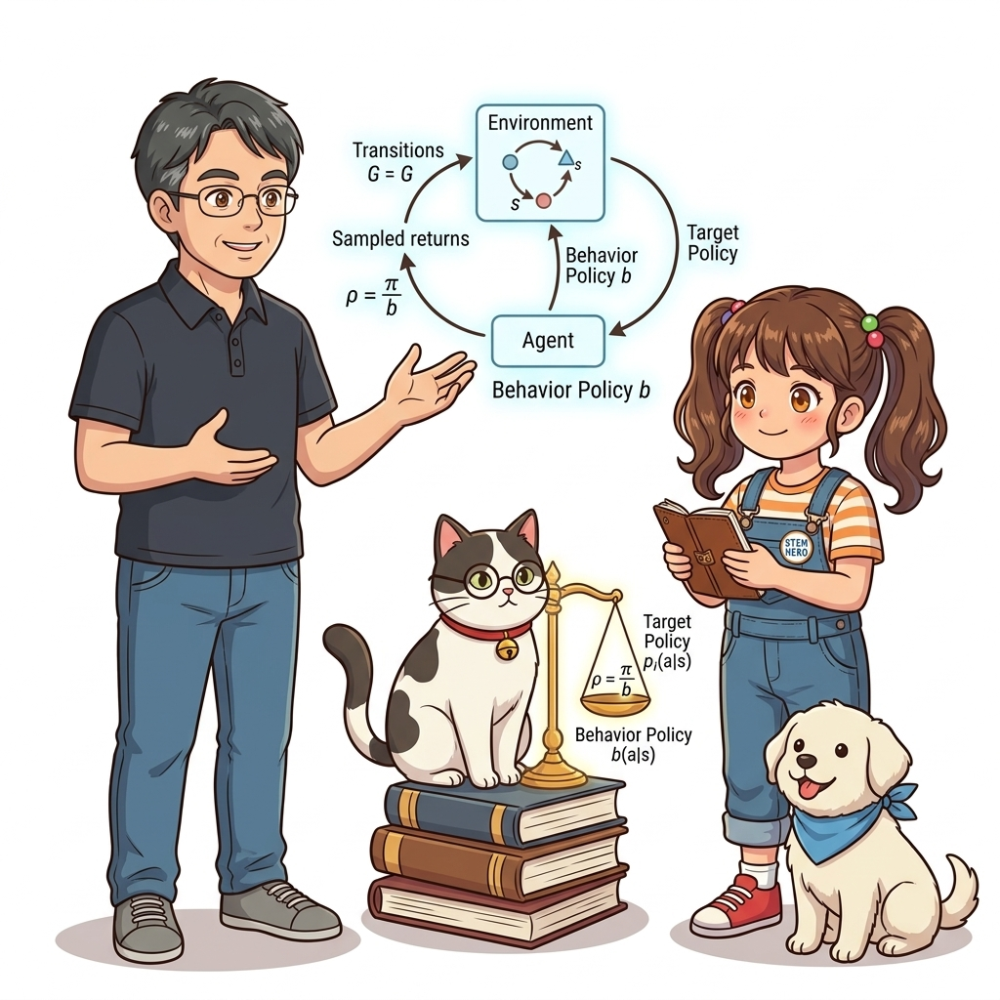
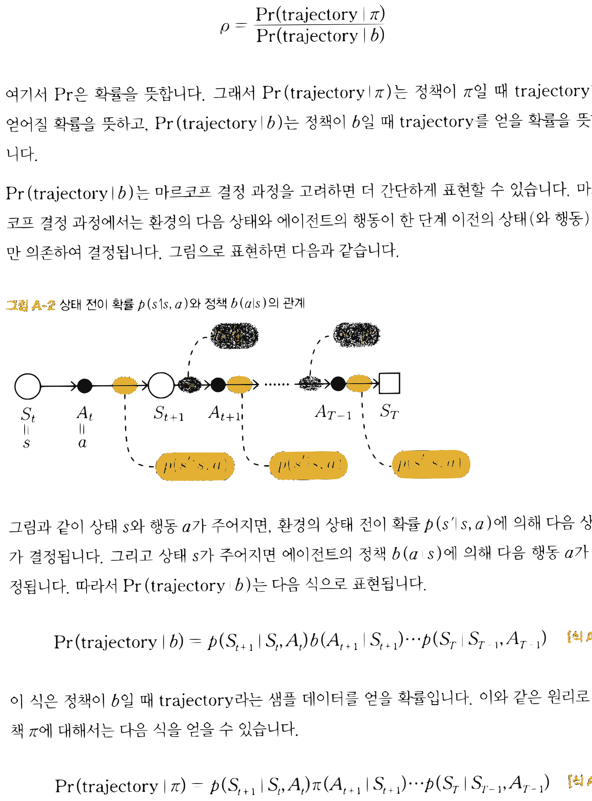
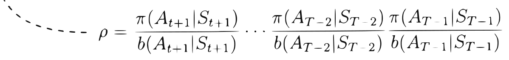

# APPENDIX A: 오프-정책 몬테카를로법 (Off-Policy Monte Carlo)

**그림 A-0** 탐험 지도(Behavior Policy)를 든 도로시와 타깃 정책책(Target Policy)을 쥔 채 확률 비율 저울을 맞추어 오프-정책을 학습하는 지니


> 행동 정책(Behavior Policy $b$)을 통해 환경을 마음껏 탐색하며 수집한 경험 데이터로부터, 우리가 진정으로 도달하고자 하는 최적 목표 정책(Target Policy $\pi$)의 가치를 정확하게 학습하는 **오프-정책 몬테카를로법**의 이론과 구현을 다룹니다. 궤적 확률 비에서 환경 전이 확률이 마법처럼 소거되는 수학적 증명과 중요도 샘플링(Importance Sampling)의 역방향 누적 알고리즘을 도로시, 지니 조교와 함께 완성해봅시다!

---

## A.1 오프-정책 몬테카를로법 이론

### 1) 온-정책과 오프-정책의 본질적 차이

온-정책(On-Policy) 몬테카를로법에서는 평가하고자 하는 대상 정책 $\pi$ 에 따라 에이전트가 직접 행동하고, 그 과정에서 얻은 수익 샘플들의 산술 평균을 구했습니다:

$$
\begin{aligned}
q_\pi(s, a) &= \mathbb{E}_\pi [ G_t \mid S_t = s, A_t = a ] \\
Q_\pi(s, a) &\approx \frac{1}{n} \sum_{i=1}^n G^{(i)} \quad (G^{(i)} \sim \pi)
\end{aligned}
$$

하지만 온-정책 방식은 **"탐색(Exploration)을 위해 무작위성을 유지해야 하면서도, 동시에 최적 행동(Greedy)을 찾아야 한다"**는 모순에 부딪힙니다.

반면 **오프-정책(Off-Policy)** 방식은 역할을 둘로 명확히 분리합니다:
1. **행동 정책 (Behavior Policy, $b$):** 온갖 모험과 무작위 탐색을 감행하며 다양한 경험 데이터를 수집하는 정책
2. **대상 정책 (Target Policy, $\pi$):** 행동 정책이 가져온 데이터를 바탕으로 100% 탐욕적(Greedy)인 최적의 길만을 날카롭게 벼려내는 정책

**그림 A-0b** 행동 정책 $b$ 가 수집한 경험 샘플을 중요도 비율 $\rho = \pi / b$ 저울로 보정하여 대상 정책 $\pi$ 의 참 가치로 환산하는 오프-정책 몬테카를로 학습도


---

### 2) 중요도 샘플링 (Importance Sampling)과 궤적 가중치 $\rho$

행동 정책 $b$ 로부터 수집된 데이터는 당연히 $b$ 의 확률 분포를 따릅니다. 이를 대상 정책 $\pi$ 의 가치로 올바르게 환산하려면, 두 확률 분포의 차이를 보정하는 **중요도 가중치(Importance Weight, $\rho$)** 를 곱해주어야 합니다:

$$
q_\pi(s, a) = \mathbb{E}_b [ \rho G_t \mid S_t = s, A_t = a ]
$$

[식 A.1] 중요도 샘플링을 적용한 행동 가치 함수

이 수식을 몬테카를로 표본 평균으로 근사하면 다음과 같습니다:

$$
Q_\pi(s, a) \approx \frac{1}{n} \sum_{i=1}^n \rho^{(i)} G^{(i)} \quad (G^{(i)} \sim b)
$$

그렇다면 시점 $t$ 부터 에피소드 종료 시점 $T$ 까지의 궤적(Trajectory)에 대한 중요도 가중치 $\rho$ 는 어떻게 계산할까요?

**그림 A-1** 상태 $S_t = s$, 행동 $A_t = a$ 에서 시작하여 행동 정책 $b$ 에 의해 생성된 에피소드 시계열 궤적


궤적을 $\tau = (S_t, A_t, S_{t+1}, A_{t+1}, \dots, A_{T-1}, S_T)$ 라고 정의할 때, 가중치 $\rho$ 는 두 정책 하에서 이 궤적이 발생할 확률의 비율입니다:

$$
\rho = \frac{\Pr(\tau \mid \pi)}{\Pr(\tau \mid b)}
$$

---

### 3) 환경 전이 확률의 기적적인 상쇄 증명

마르코프 결정 과정(MDP)의 마르코프 성질에 따라, 상태 전이 확률 $p(s' \mid s, a)$ 와 에이전트 정책 $b(a \mid s)$ 의 상호작용으로 궤적이 생성될 결합 확률을 펼쳐보겠습니다:



$$
\Pr(\tau \mid b) = p(S_{t+1} \mid S_t, A_t) \cdot b(A_{t+1} \mid S_{t+1}) \cdot p(S_{t+2} \mid S_{t+1}, A_{t+1}) \dots p(S_T \mid S_{T-1}, A_{T-1})
$$

[식 A.2] 행동 정책 $b$ 하에서의 궤적 발생 확률

마찬가지로 대상 정책 *π* 하에서 동일한 궤적이 발생했을 확률은 다음과 같습니다:

$$
\Pr(\tau \mid \pi) = p(S_{t+1} \mid S_t, A_t) \cdot \pi(A_{t+1} \mid S_{t+1}) \cdot p(S_{t+2} \mid S_{t+1}, A_{t+1}) \dots p(S_T \mid S_{T-1}, A_{T-1})
$$

[식 A.3] 대상 정책 $\pi$ 하에서의 궤적 발생 확률

이제 두 식의 비율인 $\rho$ 를 분수 형태로 놓으면 놀라운 일이 벌어집니다:

$$
\begin{aligned}
\rho &= \frac{\Pr(\tau \mid \pi)}{\Pr(\tau \mid b)} \\
&= \frac{\pi(A_{t+1} \mid S_{t+1}) \cdot \pi(A_{t+2} \mid S_{t+2}) \dots \pi(A_{T-1} \mid S_{T-1})}{b(A_{t+1} \mid S_{t+1}) \cdot b(A_{t+2} \mid S_{t+2}) \dots b(A_{T-1} \mid S_{T-1})} \\
&= \prod_{k=t+1}^{T-1} \frac{\pi(A_k \mid S_k)}{b(A_k \mid S_k)}
\end{aligned}
$$

[식 A.4] 환경 전이 확률의 소거와 최종 중요도 가중치

분모와 분자에 똑같이 들어 있던 **환경의 물리 전이 확률 $p(s' \mid s, a)$ 들이 완벽하게 약분되어 사라집니다!  
이것이 의미하는 바는 실로 위대합니다: **우리는 환경의 내부 물리 법칙이나 복잡한 전이 확률을 1%도 알지 못해도(Model-Free), 오직 에이전트 자신이 제어하는 두 정책의 확률 비율만을 곱해주는 것만으로 오프-정책 학습을 완벽히 수행할 수 있습니다!**

---

## A.2 오프-정책 몬테카를로 알고리즘 구현

### 1) 역방향 효율적 가중치 갱신

정방향으로 시점마다 $\prod$ 를 계산하면 중복 연산이 $\mathcal{O}(T^2)$ 으로 늘어납니다. 따라서 에피소드의 끝점 $S_T$ 부터 거꾸로 역방향(reversed)으로 거슬러 올라가며 가중치를 누적 곱하는 방식을 채택합니다.



- 끝 시점 $T - 1$: $\rho = 1$
- 이전 시점 $T - 2$: $\rho \leftarrow \rho \cdot \frac{\pi(A_{T-1} \mid S_{T-1})}{b(A_{T-1} \mid S_{T-1})}$
- 이전 시점 $T - 3$: $\rho \leftarrow \rho \cdot \frac{\pi(A_{T-2} \mid S_{T-2})}{b(A_{T-2} \mid S_{T-2})}$

### 2) 파이썬 전체 코드 (`mc_control_offpolicy.py`)

<div align="right"><b>ch05/mc_control_offpolicy.py</b></div>

```python
import numpy as np
from collections import defaultdict
from common.gridworld import GridWorld
from common.utils import greedy_probs

class McOffPolicyAgent:
    def __init__(self):
        self.gamma = 0.9
        self.epsilon = 0.1             # 행동 정책의 탐색률
        self.alpha = 0.2               # 고정 학습률
        self.action_size = 4

        random_actions = {0: 0.25, 1: 0.25, 2: 0.25, 3: 0.25}
        self.pi = defaultdict(lambda: random_actions)   # 1. 대상 정책 (Target Policy)
        self.b = defaultdict(lambda: random_actions)    # 2. 행동 정책 (Behavior Policy)
        self.Q = defaultdict(lambda: 0)                 # Q 함수 테이블
        self.memory = []

    def get_action(self, state):
        # 실제 환경과의 상호작용은 항상 행동 정책 b로부터 샘플링!
        action_probs = self.b[state]
        actions = list(action_probs.keys())
        probs = list(action_probs.values())
        return np.random.choice(actions, p=probs)

    def add(self, state, action, reward):
        self.memory.append((state, action, reward))

    def reset(self):
        self.memory.clear()

    def update(self):
        G = 0
        rho = 1.0

        # 에피소드 메모리를 뒤쪽부터 거꾸로 순회
        for data in reversed(self.memory):
            state, action, reward = data
            key = (state, action)

            # 중요도 샘플링 가중치 rho를 반영한 수익 및 Q값 갱신
            G = self.gamma * rho * G + reward
            self.Q[key] += (G - self.Q[key]) * self.alpha
            
            # 중요도 비율 누적 갱신
            rho *= self.pi[state][action] / self.b[state][action]

            # 만약 대상 정책 하에서 이 행동이 선택될 확률이 0이라면 이후 과거 스텝들의 가중치는 모두 0!
            if rho == 0:
                break

            # 대상 정책 pi는 순수 탐욕 정책(epsilon=0)으로, 행동 정책 b는 epsilon-탐욕 정책으로 갱신
            self.pi[state] = greedy_probs(self.Q, state, epsilon=0)
            self.b[state] = greedy_probs(self.Q, state, self.epsilon)
```

### 코드 핵심 라인 분석

1. **`self.pi` vs `self.b`:**  
   대상 정책 `self.pi`는 학습 목표인 100% 최적 탐욕 정책(`epsilon=0`)이며, 행동 정책 `self.b`는 지속적인 모험을 위해 `epsilon=0.1`의 무작위성을 유지합니다.
2. **`G = self.gamma * rho * G + reward`:**  
   미래에서 거꾸로 전달되는 할인 수익 $G$ 에 중요도 비율 `rho`를 곱해 보정합니다.
3. **`if rho == 0: break` (조기 종료 최적화):**  
   대상 정책 $\pi$ 는 결정론적 탐욕 정책이므로, 행동 정책 $b$ 가 탐색 중에 취한 행동이 대상 정책의 최적 행동과 일치하지 않는 순간 $\pi(a \mid s) = 0$ 이 됩니다.  
   이때 `rho`는 즉시 0이 되며, 그보다 과거 시점들의 곱 역시 영원히 0이 되므로 더 이상 루프를 돌 필요 없이 즉각 탈출(break)할 수 있습니다!

---

## A.3 실험 결과 및 오프-정책 MC의 한계

3×4 그리드 월드 환경에서 오프-정책 몬테카를로 에이전트를 학습시킨 결과입니다.


에이전트는 행동 정책의 무작위 탐색 데이터로부터도 완벽한 최적 정책(골 지점으로 향하는 최단 경로 화살표)을 성공적으로 수렴해 냈습니다.

> [!CAUTION]
> **오프-정책 몬테카를로법의 치명적 한계: 분산 폭발(Variance Explosion)**  
> 그리드 월드 같은 작은 환경에서는 잘 작동하지만, 에피소드 길이가 길어지는 복잡한 환경에서는 오프-정책 MC가 극도로 취약해집니다.  
> $\rho$ 는 비율들의 연속된 곱($\prod$) 형태이기 때문에, 비정상적으로 큰 값이 곱해지면 $\rho$ 가 수백만으로 폭발하거나, 반대로 0으로 순식간에 소멸해 버립니다. 이 극심한 분산 문제를 해결하기 위해 부트스트랩을 도입한 것이 바로 10장에서 배운 **오프-정책 SARSA**와 **Q-러닝**입니다!
