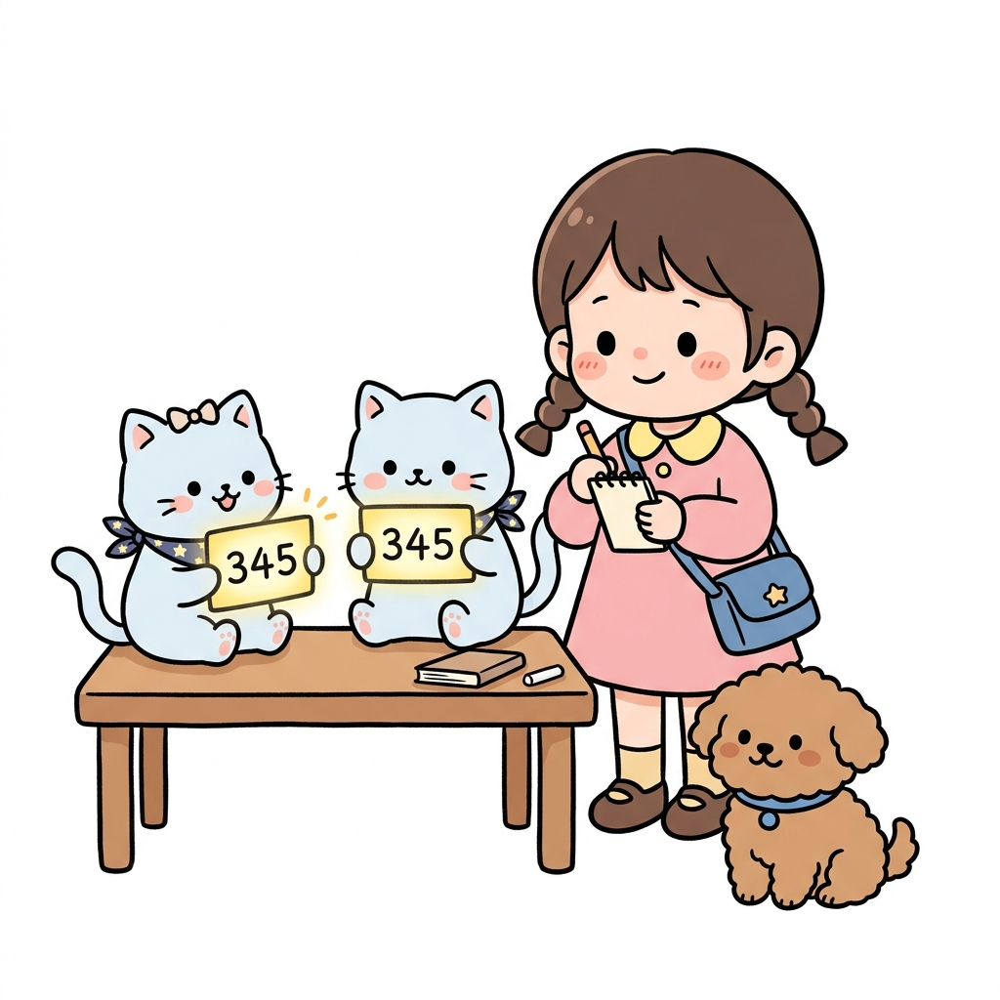
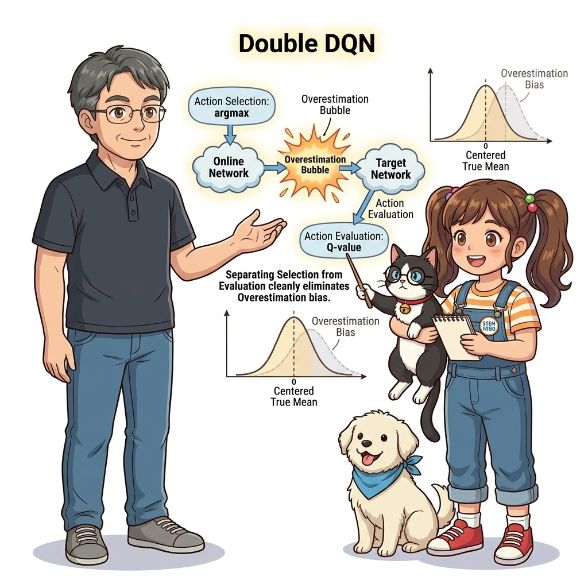
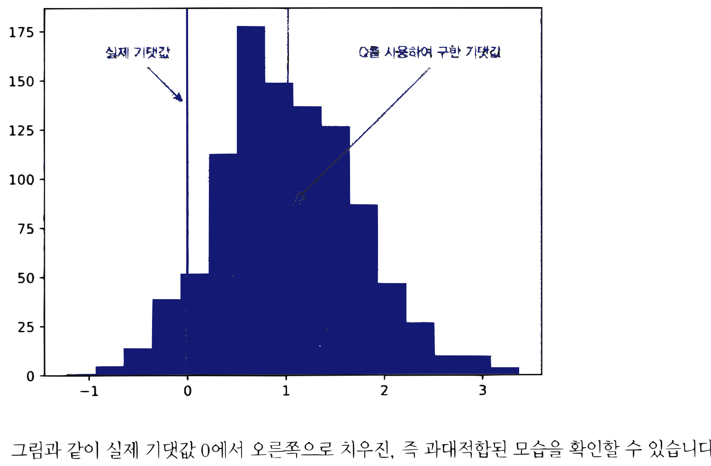
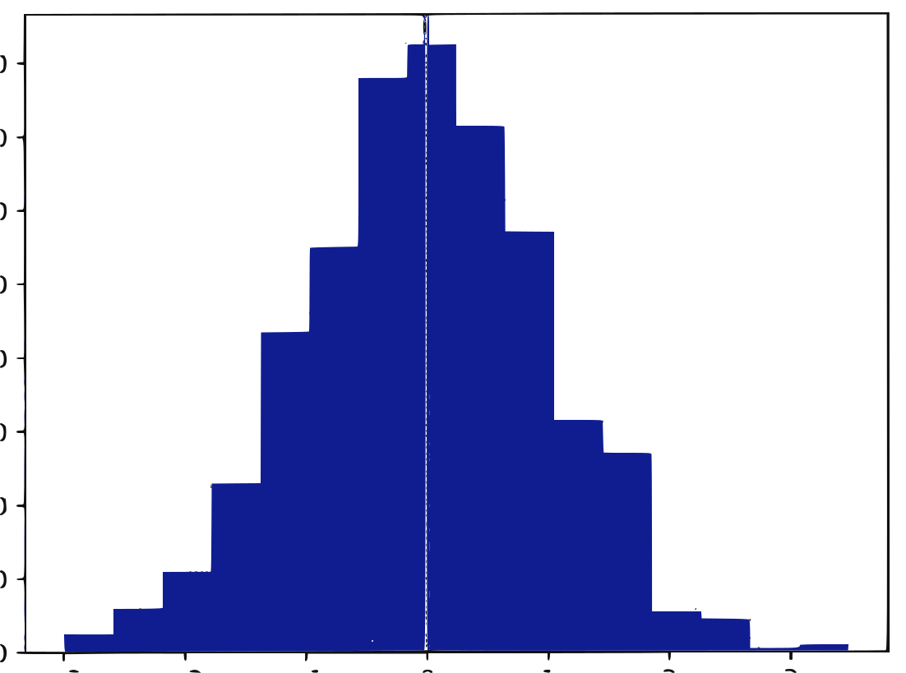

# APPENDIX C: Double DQN 이해하기

**그림 C-0** Q1, Q2 두 장의 보물가치 카드를 교차 검증하며 과대평가 거품을 걷어내는 쌍둥이 지니 요정과 도로시


> 12장 DQN의 벨만 최적 타깃 계산에 숨겨진 치명적 결함인 **과대평가 편향(Overestimation Bias)**의 수학적 원인을 파헤치고, 추가 신경망 증설 없이 기존의 타깃 네트워크를 활용하여 행동 선택과 가치 평가를 우아하게 분리해 낸 **Double DQN**의 원리를 도로시, 지니 조교와 함께 완벽히 정복해봅시다!

---

12장에서 우리는 오리지널 DQN의 TD 목표에 잠재된 심각한 과대평가 문제를 지적했습니다. 구체적으로는 다음 TD 목표 계산에서 문제가 발생합니다:

$$
Y_t^{\text{DQN}} = R_t + \gamma \max_a Q_{\theta^-}(S_{t+1}, a)
$$

여기서 $\max_a Q$ 연산이 왜 시스템 전체의 가치를 터무니없이 부풀리는 '거품(Overestimation)'을 형성하고 학습을 불안정하게 만드는지, 그리고 Double DQN은 이를 어떻게 단 한 줄의 수식 변경으로 완벽히 치유했는지 알아보겠습니다.

**그림 C-0b** 단일 max 연산으로 발생하는 통계적 과대평가 거품을 행동 선택(온라인망)과 가치 평가(타깃망)의 분리로 완벽히 제거하는 Double DQN


---

## C.1 DQN의 max 연산은 왜 항상 가치를 과대평가하는가?

아주 간단하고 극단적인 사고 실험을 해보겠습니다.  
어떤 상태 $s$ 에서 선택 가능한 행동이 4개($a_0, a_1, a_2, a_3$) 있고, 실제 환경에서 이 네 행동의 참된 가치는 모두 똑같이 **0점**이라고 가정해 봅시다:

$$
q(s, a_0) = q(s, a_1) = q(s, a_2) = q(s, a_3) = 0
$$

이 네 행동의 참 가치 중에서 최댓값을 취하면 당연히 0입니다:

$$
\max_a q(s, a) = \max(0, 0, 0, 0) = 0
$$

### 추정 오차(노이즈)와 max의 만남: 옌센 부등식

하지만 실제 강화학습 에이전트는 참 가치 $q$ 를 모르며, 신경망이 출력하는 **추정치 $Q(s, a)$** 를 사용합니다.  
신경망의 추정치에는 항상 통계적 오차(가우스 잡음)가 섞여 있습니다. 평균이 0이고 표준편차가 1인 정규분포 $\mathcal{N}(0, 1)$ 의 노이즈가 4개 행동의 $Q$ 값에 각각 더해졌다고 가정해 보죠:

- $Q(s, a_0) = -0.52$
- $Q(s, a_1) = \mathbf{+1.21}$  ← 우연히 양수 노이즈가 튐!
- $Q(s, a_2) = -0.18$
- $Q(s, a_3) = +0.44$

이제 이 4개의 추정치 중에서 `max()`를 취하면 어떻게 될까요?  
우연히 가장 큰 양수 노이즈가 튄 $a_1$ 의 값인 **+1.21** 이 최댓값으로 선발됩니다!

수학적으로 볼록 함수(Convex function)인 max 연산에 기대값을 취하면 다음 부등식이 항상 성립합니다:

$$
\mathbb{E} [ \max_a Q(s, a) ] \ge \max_a \mathbb{E} [ Q(s, a) ] = 0
$$

참값은 0인데, 단지 `max`를 취했다는 이유만으로 기대값이 항상 0보다 큰 양수가 되어버립니다. 이것이 바로 통계학에서 말하는 **최대화 편향(Maximization Bias)**이자 강화학습의 **과대평가(Overestimation)**입니다!

### 파이썬 코드로 검증하는 과대평가 시뮬레이션

```python
import numpy as np
import matplotlib.pyplot as plt

samples = 1000
action_size = 4
Qs = []

for _ in range(samples):
    # 평균 0, 표준편차 1인 정규분포 노이즈를 가진 4개 행동의 추정치 생성
    Q = np.random.randn(action_size)
    Qs.append(Q.max()) # 최댓값만 수집!

# 히스토그램 시각화
plt.hist(Qs, bins=16)
plt.axvline(x=0, color='red', linestyle='--', label='True Mean (0.0)')
plt.axvline(x=np.array(Qs).mean(), color='cyan', label=f'Estimated Mean ({np.mean(Qs):.2f})')
plt.legend()
plt.show()
```



시뮬레이션 결과, 실제 평균은 0이어야 하지만 `Q.max()`의 평균은 약 **+1.03** 부근으로 심각하게 오른쪽으로 쏠린 채 과대평가되는 것을 확인할 수 있습니다.

이 왜곡된 가치가 TD 타깃에 들어가고, 다시 신경망으로 학습되며, 다음 스텝에서 또 과대평가되는 악순환(Positive Feedback Loop)이 반복되면 $Q$ 값 전체에 거대한 거품이 끼어 학습이 산으로 가버립니다.

---

## C.2 Double DQN의 해법: 행동 선택과 가치 평가의 디커플링

과대평가가 발생하는 근본 원인은 **"최고의 행동을 고르는 잣대"**와 **"그 행동의 점수를 매기는 잣대"**를 **단 하나의 동일한 신경망**으로 처리했기 때문입니다.

시험 문제를 낸 학생이 자기 시험지를 스스로 채점하면 당연히 점수가 후하게 매겨지는 것과 같습니다. 이를 방지하려면 채점관을 분리해야 합니다:
1. **행동 선택 (Selection):** 어떤 행동이 가장 유망한지 argmax로 선택하는 역할
2. **가치 평가 (Evaluation):** 선택된 그 행동의 실제 가치가 얼마인지 평가하는 역할

### 파이썬 코드로 확인하는 디커플링 효과

두 개의 독립된 Q 함수 추정치(`Q`와 `Q_prime`)를 준비하여 역할을 나눕니다:

```python
import numpy as np
import matplotlib.pyplot as plt

samples = 1000
action_size = 4
Qs = []

for _ in range(samples):
    Q = np.random.randn(action_size)          # 첫 번째 신경망
    Q_prime = np.random.randn(action_size)    # 두 번째 신경망 (독립된 잡음)
    
    idx = np.argmax(Q)                        # 1. Q로 최대 행동 인덱스 선택
    Qs.append(Q_prime[idx])                   # 2. 값 평가는 다른 Q_prime에서 추출!

plt.hist(Qs, bins=16)
plt.axvline(x=0, color='red', linestyle='--', label='True Mean (0.0)')
plt.axvline(x=np.array(Qs).mean(), color='cyan', label=f'Double Mean ({np.mean(Qs):.2f})')
plt.legend()
plt.show()
```



결과는 놀랍습니다!  
히스토그램이 완벽하게 0을 중심으로 대칭 분포를 이루며, 평균값 역시 참 기댓값인 **0.00**에 완벽하게 일치합니다. 과대평가 거품이 깨끗하게 걷힌 것입니다!

---

## C.3 DQN에 적용: 추가 비용이 전혀 없는 천재적 설계

이 Double Q-러닝의 아이디어를 딥러닝 기반의 DQN에 적용하려면 신경망을 2배로 늘려야 할까요?  
놀랍게도 **추가 신경망이 단 1개도 필요 없습니다!**

DQN은 이미 12장에서 배운 두 개의 신경망을 기본적으로 보유하고 있습니다:
- **온라인 신경망 (Online Network, 파라미터 $\theta$):** 실시간으로 경사 하강 갱신되는 현재 신경망
- **타깃 신경망 (Target Network, 파라미터 $\theta^-$):** 주기적으로 동기화되는 안정적인 기준 신경망

하도 반 하셀트(Hado van Hasselt) 연구팀은 2015년, 이 기존의 두 네트워크를 활용하여 Double DQN의 수식을 다음과 같이 완성했습니다<sup>[29]</sup>:

$$
Y_t^{\text{Double}} = R_t + \gamma Q\left( S_{t+1}, \arg\max_a Q(S_{t+1}, a; \theta); \theta^- \right)
$$

[식 C.1] Double DQN의 타깃 계산식

- **행동 선택 (`argmax`):** 실시간으로 가장 똑똑하게 학습 중인 **온라인 신경망 $\theta$** 가 최선의 행동 $a^*$ 를 고릅니다.
- **가치 평가 (`Q(s, a*; θ^-)`):** 보수적이고 차분한 **타깃 신경망 $\theta^-$** 가 그 행동 $a^*$ 의 가치를 객관적으로 평가합니다.

단 한 줄의 코드 수정만으로, 파라미터나 계산량의 증가 없이 DQN의 고질병이었던 가치 과대평가를 완벽하게 치료한 것입니다!
