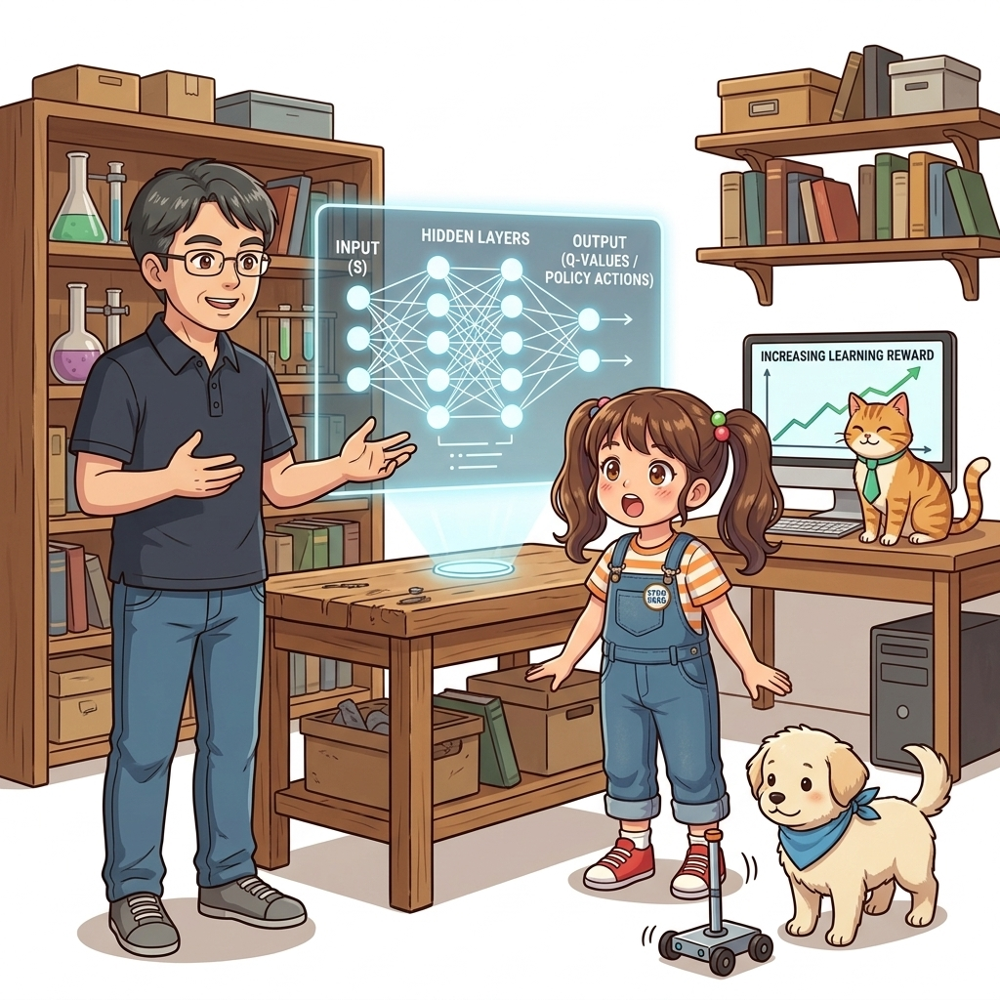

# 강화학습 Part 3: 고급 강화학습

강화학습 알고리즘과 심층 신경망(Deep Neural Network)의 극적인 결합을 다룹니다. 상태 공간이 무한해지는 고차원 문제를 해결하기 위한 가치 함수 근사법부터 시작하여, 아타리 게임을 인간 수준으로 정복한 DQN 알고리즘, 그리고 가치를 거치지 않고 최적 정책을 직접 미분하여 학습하는 정책 경사법(Policy Gradient) 계열의 핵심 이론을 직접 DeZero 프레임워크로 구현합니다.

**그림 Part 3** 이호진 교수님이 인공신경망 홀로그램 회로망과 카트폴 로봇을 통해 딥러닝과 강화학습의 결합(DQN, 정책 경사법)을 설명하고, 도로시와 지니, 토토가 신비롭게 탐구하는 모습

## 학습 단원 목록

- **[11강 신경망과 Q 러닝](../11_신경망과_Q_러닝/)**
  - 테이블 형태 가치 함수의 차원의 저주 한계를 극복하기 위해, DeZero 프레임워크를 기반으로 인공 신경망(Neural Network) 가치 함수 근사 기법을 도입합니다.

- **[12강 DQN](../12_DQN/)**
  - OpenAI Gym 환경 제어법을 익히고, DQN의 2대 혁신 기술인 Experience Replay(경험 재생)와 Target Network를 적용하여 카트폴 및 아타리 에이전트를 구축합니다.

- **[13강 정책 경사법](../13_정책_경사법/)**
  - 최적 정책을 직접 뉴럴 네트워크 파라미터로 근사하여 업데이트하는 REINFORCE 알고리즘과, 분산을 낮추기 위한 Baseline이 가미된 Actor-Critic(행위자-비평자) 기법을 학습합니다.

---

딥러닝의 마법이 강화학습의 에이전트와 만나 눈부시게 진화하는 고급 단계입니다. 준비가 되었다면 좌측 메뉴의 **11강 신경망과 Q 러닝**을 통해 빛나는 인공지능의 시각을 완성해보세요!
